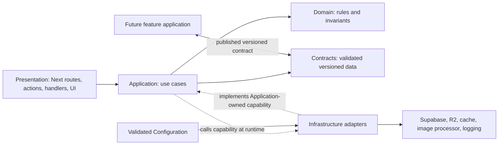

# Codebase structure

Baseline `230adeca680c0fe7e22b3ece0fd9169764b84ffe`, inspected 2026-10-30. This document separates the verified source layout, the narrow Phase 1 extraction now present in this worktree, and the remaining target boundaries. The extraction covers contact-draft save/publish orchestration and a versioned Contact Projection contract; it does not establish a general layered architecture or separate deployment entry points. See [current architecture](current-architecture.md), [migration plan](../migration/migration-plan.md), and [phase gates](../migration/migration-spec.md).

## Current layout

The repository is one Next.js App Router application organized by runtime role and then by domain. Routes, Server Actions and Route Handlers live in `src/app/`; shared UI is in `src/components/`; domain-oriented code is in `src/lib/<domain>/`. These locations are useful ownership boundaries, but they do not currently form clean Presentation, Application, Domain and Infrastructure layers.

```text
src/
  app/                       Next.js routes, layouts, handlers and Server Actions
    admin/                   owner UI and route-local _components
    api/admin/               staff mutations, uploads, draft and preview
    api/media/               managed-media reader
    auth/ login/              sign-in, callback and signout
    b/[slug]/                 public Portfolio and contact VCF
    c/[token]/                card redirect and contact VCF
  components/{admin,business,ui}/
  lib/
    admin/ auth/              current admin helpers and owner/capability checks
    business/                 content, drafts, publication reads, contacts, VCF and draft workflow
    cards/                     card snapshots and manufacturing/export helpers
    config/                    environment and feature-flag checks
    contracts/                 Contact Projection v1 runtime schema (added in Phase 1)
    media/                     image, storage and media-read helpers
    observability/ security/ supabase/ (includes the contact-draft Supabase adapter)
  middleware.ts instrumentation.ts instrumentation-client.ts
supabase/migrations/          schema, RLS, RPCs and database invariants
supabase/tests/ tests/unit/ tests/e2e/
```

`@/*` maps to `src/*`. Keep route-specific UI in that route's `_components/` folder. Keep Next.js middleware and instrumentation directly under `src/`. The proposed responsibilities below do not require a folder for every layer or the same folders in every domain.

## Responsibilities and direction

These are logical boundaries. Existing files may currently implement more than one responsibility; the capability map identifies those cases.

| Responsibility | Owns | May depend on | Must not own |
| --- | --- | --- | --- |
| Presentation | Next.js routes, layouts, Server Actions, Route Handlers, React components and browser/UI state. Translates HTTP/form input and use-case results into rendering, status, headers, redirects and local UI updates. | Application use cases; validated Contracts needed to render or transport data; Next.js and React at this boundary. | Business workflows, direct provider policy or database authorization rules. A handler may establish the request context, but should not become the workflow. |
| Application | A specific workflow or read use case called by a route/action, such as save draft, publish page, prepare media or resolve a card. Coordinates steps and failure handling. | Domain rules, Contracts and only workflow-specific capability contracts. Infrastructure implementations are wired at the composition boundary. Add a narrow capability shape only when there is a real provider, runtime or test variation. | Next.js request/response behavior, UI state, provider SDK details or domain invariants duplicated from the database. |
| Domain | Provider-independent rules and invariants: valid content, slug/contact/card rules, state transitions and decisions that remain true regardless of hosting or storage provider. | Other domain concepts only where ownership is clear; dependency-free value types where practical. | Next.js, React, Supabase, Cloudflare, Node/browser APIs, environment access, logging SDKs or network/storage calls. |
| Infrastructure | Provider and runtime adapters for Supabase/Auth/RPC, R2, cache/CDN operations, image processing/storage and logging/telemetry. Maps provider data and failures to the narrow needs of an Application use case. | Provider SDKs, runtime APIs, Contracts and the local capability shape it implements. | Product workflow orchestration or imports from Presentation. Provider authorization still comes from provider bindings, database grants and RLS, not TypeScript interfaces. |
| Contracts | Validated, versioned data that crosses an application or module boundary: published Portfolio snapshots, feature descriptors and other explicitly serialized inputs/outputs. Defines allowed fields and compatibility rules. | Stable primitive/value definitions and a runtime validator appropriate to the payload. | Database rows as-is, credentials, drafts, private contact data, provider clients or assumptions that two deployments release together. A TypeScript type assertion alone is not runtime validation. |
| Configuration | Validated environment identity and runtime settings, including bindings, hostnames, feature switches and limits. Fails closed when required values are missing or conflict. | Runtime environment at the composition/startup boundary. | Business decisions, implicit defaults that cross environments, or secret values in browser/Public configuration. |

The intended dependency direction is from entry points toward use cases and rules. Infrastructure meets Application through a use-case-specific boundary only where needed; Contracts and validated Configuration enter at explicit boundaries. Domain does not depend outward on frameworks or providers.

The concrete Phase 1 slice keeps `src/app/admin/businesses/draft-actions.ts` as the Next.js entry point. It calls `src/lib/business/draft-workflow.ts`, which owns revision checks and persistence-result mapping and accepts a persistence function; `src/lib/supabase/contact-draft-persistence.ts` owns contact-photo preparation and the Supabase RPC. The workflow remains beside its business domain rather than in a new generic application tree. `src/lib/contracts/contact-projection-v1.ts` defines the strict runtime-validated v1 contact wire shape used by `src/lib/business/contact.ts`, publication types and VCF serialization. `tests/unit/business-module-boundaries.test.ts` checks these actual module edges. Other routes and modules remain in their mixed state described below.



No generic `services`, `ports` or `shared` directory is proposed. If a workflow needs an adapter boundary, keep its narrow interface beside that workflow and add an implementation at the existing domain/provider ownership location. The wiring belongs at the application entry boundary. An abstraction is justified by an actual provider/runtime variation, test need or independently deployed consumer, not by the diagram.

## Capability map: current and proposed

The source paths below were checked against the baseline and the Phase 1 worktree. "Current" describes the code as it stands after this narrow extraction, including existing mixed responsibilities. "Proposed" describes further responsibility boundaries, not a claim that those splits already exist.

| Capability | Current source and mixed responsibility | Proposed responsibility and dependency flow |
| --- | --- | --- |
| Business editing | `src/app/admin/businesses/[id]/page.tsx` and `src/app/admin/businesses/_components/business-editor.tsx` render the editor. `src/app/admin/businesses/draft-actions.ts` still handles Server Action authorization, request parsing, result/redirect handling and `revalidatePath`, but now calls `src/lib/business/draft-workflow.ts` for revision checks and outcome mapping and `src/lib/supabase/contact-draft-persistence.ts` for photo preparation and `save_contact_draft`. The separate `src/app/admin/businesses/actions.ts` remains mixed across action transport, validation, Supabase calls and Next responses; `src/lib/business/draft.ts` and `content.ts` retain reusable parsing/rules. | Presentation keeps the page, editor, action signatures and Next responses. The extracted save-draft Application workflow coordinates revision checks and persistence through its injected function. Domain keeps provider-independent content and slug invariants. Supabase/RPC work stays in Infrastructure, with SQL constraints/RLS authoritative for concurrency and access. Parsing, authorization and other actions remain candidates only when a focused extraction has a real benefit. |
| Publishing | `src/app/admin/businesses/draft-actions.ts` can save and publish through `save_contact_draft` and now delegates that call through the extracted workflow/adapter. `src/app/admin/businesses/actions.ts` still calls `publish_page` directly. `src/lib/business/publication.ts` defines a `PublicationSnapshot` TypeScript shape using Contact Projection v1, but the full snapshot is not yet runtime-validated. `src/lib/business/public-publication.ts` still combines Supabase pointer/snapshot RPCs, Next/React caching, local rate limiting and error telemetry. | A broader Admin publication coordinator should eventually combine consistent revision capture, content/media validation and publication activation around the existing workflow. Domain decides publishable state; Supabase operations belong behind Infrastructure boundaries. The later, separately gated artifact protocol adds R2 writes, verification and pointer activation; it is not in this Phase 1 slice, and database and R2 are not one transaction. |
| Media | `src/app/api/admin/media/route.ts` and `src/app/api/admin/businesses/contact-preview/route.ts` handle HTTP, validation, authorization and media work. `src/lib/media/optimize.ts`, `src/lib/media/resolve-contact-photo.ts` and `src/lib/media/read-object.ts` cover processing/storage/read behavior; `src/components/business/managed-image.tsx` renders public media. The current paths mix request policy, image work and Supabase storage details. | Presentation enforces request shape and response behavior. A media Application use case applies upload/preview policy. Domain owns provider-independent media eligibility and bounds. Infrastructure supplies the current image processor and private Supabase storage; approved public-derivative/R2 delivery is a later migration capability. Private contact photos remain distinct from public display media. |
| Cards, QR and NFC | Admin inventory routes/handlers, including `src/app/admin/cards/page.tsx`, `src/app/admin/cards/export/route.ts`, `src/app/api/admin/cards/assignment/route.ts`, `src/app/api/admin/cards/deletion/route.ts` and `src/lib/cards/card-manufacturing.ts`, mix route access, database operations and export generation. `src/app/c/[token]/route.ts` currently validates/rate-limits the token, calls the `resolve_card` RPC, logs failures and builds the redirect in one handler. | Admin Presentation calls inventory/manufacturing workflows; Domain owns serial, eligibility and output invariants; Infrastructure uses Supabase for live assignment/eligibility and bounded QR/export generation. The `/c/[token]` route remains an explicit dynamic exception because a QR/NFC visit must see current card state and fail closed when it cannot. |
| Contacts and VCF | Contact editing lives in `src/app/admin/businesses/draft-actions.ts`, `src/lib/business/contact.ts` and `src/app/admin/businesses/_components/business-editor.tsx`. `src/lib/contracts/contact-projection-v1.ts` now validates the versioned projection, and `src/lib/business/vcard.ts` validates it before serialization. `src/lib/business/contact-download.ts` still combines Supabase eligibility RPCs, rate limiting, private media reads, VCF response headers and serialization. Both `src/app/b/[slug]/contact.vcf/route.ts` and `src/app/c/[token]/contact.vcf/route.ts` call it. | Domain validates contact invariants; the Contract allowlists and validates the VCF projection. A VCF use case should check current eligibility, obtain only authorized photo bytes and serialize output; Infrastructure performs live Supabase/media reads. Presentation preserves GET/HEAD, download behavior and no-store/privacy headers. These two VCF endpoints are explicit dynamic exceptions to ordinary Portfolio artifact delivery. |

Other relevant current locations include `src/lib/auth/owner.ts` (owner/capability checks), `src/lib/supabase/server.ts` and `src/lib/supabase/public.ts` (Supabase clients), `src/lib/config/environment.mjs` (environment guard), `src/lib/observability/operations.ts` (error capture), `src/lib/security/rate-limit.ts` (in-process limits), and `supabase/migrations/` (database constraints, grants, RLS and RPC behavior). Their locations do not by themselves mean each is already a clean adapter or isolated layer.

## Verified Phase 1 import closures

Read-only source import analysis was run against this worktree on 2026-10-30 with the TypeScript AST, following runtime imports, re-exports and literal dynamic imports into src. Type-only imports erased at runtime are excluded. These counts describe source closures, not emitted bundles, route manifests, deployment bindings or credential isolation.

~~~mermaid
flowchart LR
  R[POST draft Route Handler] --> A[Admin business actions module]
  A --> S[Draft Server Actions]
  R --> O[Owner lookup and request checks]
  O --> SSR[Supabase SSR server client]
  S --> W[Business draft workflow]
  W --> D[Business draft rules]
  S --> P[Contact draft persistence adapter]
  P --> M[Contact photo media resolver]
  M --> SH[Sharp image processing]
  M --> SSR
  S --> TEL[Sentry operation telemetry]
  SSR --> DB[Supabase Auth and PostgREST]
  P --> DB
  PAGE[Public b slug page] --> PUB[Public publication lookup]
  PUB --> CLIENT[Public Supabase client]
  CLIENT --> RPC[Pointer snapshot and fallback RPCs]
  PUB --> CACHE[Next cache and local rate limit]
  PAGE --> SNAP[Public snapshot renderer]
  SNAP --> IMG[Managed image component]
  IMG -. separate HTTP request .-> MEDIA[Media Route Handler]
  MEDIA --> OBJ[Managed object reader]
  OBJ --> STORAGE[Supabase Storage]
~~~

The editor save request enters through `src/app/api/admin/businesses/draft/route.ts`, which imports `src/app/admin/businesses/actions.ts` and then the extracted `src/app/admin/businesses/draft-actions.ts` module. That route still owns request bounds, origin checks, owner lookup and throttling. The action retains Next.js authorization/result/revalidation behavior; `src/lib/business/draft-workflow.ts` owns revision validation and persistence-result mapping; `src/lib/supabase/contact-draft-persistence.ts` performs the current Supabase RPC and contact-photo preparation.

| Entry point | Runtime source closure | Verified transitive provider path |
| --- | --- | --- |
| Admin draft Server Action | 19 first-party src modules | `src/lib/auth/owner.ts` -> `src/lib/supabase/server.ts` -> `@supabase/ssr` for Auth and database access. Persistence reaches `src/lib/media/resolve-contact-photo.ts` and `src/lib/media/inspect.ts` for current Supabase Storage and Sharp work; `src/lib/observability/operations.ts` reaches Sentry. The persistence adapter's `SupabaseClient` import from `@supabase/supabase-js` is type-only and erased. |
| Admin draft POST route | 24 first-party src modules | Includes the Server Action closure plus `actions.ts`, request-origin/rate-limit modules and its static `node:crypto` dependency. The route creates its SSR Supabase client directly before calling the action wrapper. |
| Public `/b/[slug]` page | 22 first-party src modules | `src/lib/business/public-publication.ts` -> `src/lib/supabase/public.ts` -> runtime `@supabase/supabase-js`. It calls `get_publication_pointer`, `get_publication_snapshot` and compatibility fallback `get_published_page`; lookup also uses Next cache, process-local rate limits and Sentry error telemetry. |

The public page imports `src/components/business/managed-image.tsx`, which can request `/api/media/[...path]` as a separate HTTP request; that route is not part of the page's import closure. `src/app/api/media/[...path]/route.ts` and `src/lib/media/read-object.ts` currently fetch managed objects from Supabase Storage using the public URL/key and may use the SSR client for private owner reads. This is another existing provider dependency of some Portfolio media requests.

This graph records the current mixed responsibilities. The live Supabase read in `/b/[slug]` is existing behavior, not a Phase 1 failure; removing it belongs to the later Public-delivery phase. The QR/NFC and VCF handlers are separate dynamic entry points and are not part of the ordinary page closure. Neither this source graph nor the Phase 1 boundary test proves deployment, route-manifest or credential isolation.

## Incremental transition

Keep the existing `src/lib/<domain>` ownership and Next.js route conventions while drawing boundaries one real workflow at a time:

1. Map imports and behavior for the chosen workflow, including SQL/RPC authority, runtime constraints and callers. Do not move files just to match a diagram.
2. Extract or clarify provider-independent rules in the domain-owned files already used by that workflow. Keep route-specific UI and HTTP semantics in the existing App Router locations.
3. Move orchestration out of a long action/handler only when it becomes a real reusable/testable workflow. Keep it beside its owning domain initially; introduce a separate application module only where it materially clarifies ownership.
4. Put provider calls behind a narrow workflow-specific adapter boundary only when a real runtime/provider or test variation requires it. Retain Supabase SQL as authority for authorization and transactional invariants.
5. Define and runtime-validate a versioned Contract when data crosses the Admin/Public or feature-app boundary. Do not expose database records directly or create an empty registry/abstraction in anticipation of future features.
6. Prove the import boundary and unchanged behavior before repeating the extraction for another capability.

Do not require identical folders in `business`, `cards` and `media`; do not move Next routes to a new `apps/` tree, add packages/tooling, or create empty directories as part of the boundary work. Existing route-local `_components/`, `src/lib/<domain>`, `@/*`, Vitest and E2E conventions remain the starting point. The approved Phase 1 change is behavior-preserving and limited to the concrete slice above; it does not include Worker rollout, R2 artifact publishing or feature redesign. R2 artifact writes and activation belong to a later approved migration phase.

## Import and runtime rules

These are target rules for approved, incremental work. Some current files listed above intentionally do not satisfy them yet.

1. Presentation calls Application workflows/read use cases and renders Contracts. Server Actions and Route Handlers translate transport details; they must not grow into the workflow or create provider clients directly.
2. Application depends on Domain and Contracts. It reaches Infrastructure only through a specific capability needed by that use case. Domain has no imports from Presentation, Application, Infrastructure, frameworks, providers or runtime configuration.
3. Infrastructure depends inward on the capability it implements and the Contract/domain values it maps. It does not import routes, components or other providers' private modules.
4. Contract payloads are runtime-validated at producer and consumer boundaries. They contain only allowlisted public data; no draft, credential, Admin flag, card token, private contact/photo or raw provider/database row.
5. Ordinary Public Portfolio delivery consumes a published, versioned Contract and its prepared HTML/artifact. It must not import or call Supabase, Auth, Admin code, cookies, draft reads or private-media access. Public display images come from approved public immutable media URLs. The current `/b/[slug]` Supabase lookup is a known violation of this later Public-delivery target; it is documented current behavior, not a Phase 1 failure.
6. The only planned live Supabase exceptions on Public are QR/NFC resolution at `/c/[token]` and current-eligibility VCF at `/b/[slug]/contact.vcf` and `/c/[token]/contact.vcf`. Keep those routes narrow, dynamic, no-store where specified, and fail closed. Do not let an exception become an import path from ordinary Portfolio rendering.
7. Admin-only code and secrets must be absent from the Public route manifest, transitive server dependency closure, browser chunks and runtime bindings. A Public read-only R2 binding is provider-enforced; a TypeScript get-only interface is not an access control.
8. Configuration is validated at runtime composition/startup and passed only to the server adapter that needs it. Domain, Contracts and browser code do not read environment variables. Missing or conflicting deployment identity fails closed.
9. Prevent dependency cycles and private cross-domain imports. Prefer an explicit exported capability or Contract over importing another domain's implementation details.

Directory layout alone does not provide deploy, network or credential isolation. Separate build inputs/outputs, route manifests, runtime bindings, secrets, service identities and provider permissions are required. The Public deployment must be unable to write/list R2 and must not receive Admin or Supabase service credentials; enforce and test this at the provider/deployment boundary.

## Deployments and shared Contracts

The baseline is one Next.js App Router application; the separation below is the target in the migration plan. Admin and Public remain in this repository initially, but produce independently configured and deployed applications: Admin owns authenticated UI/actions, Supabase Auth, drafts, cards, uploads/private preview and the publish coordinator; Public owns prepared Portfolio delivery plus only the named dynamic exceptions. Preserve Next.js route conventions while the boundary is established. Create a distinct Public entry/build only when the dependency graph and route tests prove what it must include. Two deployments do not require a monorepo or moving Admin into `apps/admin`.

Each deployment gets its own build/deploy identity, route surface, host, secrets and bindings. Admin can write only approved publication objects; Public reads the required artifacts through a provider-enforced read-only binding. Supabase Auth/Admin credentials are not present in Public. Directory names, a source-level interface or a shared package cannot create those permissions. Production remains on Vercel until its separately approved cutover.

Substantial future feature applications remain independently owned and deployed, normally with their own repository, frontend/backend, data and migrations, tenant authorization and release schedule. Core/Admin may publish a small versioned descriptor or link in the Portfolio Contract. Portfolio does not read the feature database or runtime, and a descriptor/link never grants the feature's own access. Contracts suitable for sharing are serialized schemas and conformance fixtures for the published snapshot, feature descriptors and other intentionally public wire formats. Do not share provider adapters, server credentials, session/auth implementations or feature data tables.

Give each payload an explicit schema version and validate it when written and read. Compatible additive fields may remain in a version when old readers can safely ignore them; a breaking shape gets a new version. Deploy readers that accept both supported versions before a writer emits a new one, retain old artifacts for the agreed compatibility window, and retire old support only after consumers have moved. Unknown versions fail closed with a diagnosable error. This lets Admin, Public and feature apps release independently without requiring lockstep deployment. The version support window and deprecation policy must be agreed when the first cross-deployment Contract is implemented.

## Dependency-flow examples

- **Admin publish:** `src/app/admin/businesses/draft-actions.ts` receives and authorizes the Server Action request, then calls `saveContactDraftWorkflow(draft, publish, persist)`. The workflow validates revision inputs and maps adapter outcomes; `persistContactDraft` prepares contact media and invokes `save_contact_draft`. The action retains redirect/revalidation behavior. This preserves the existing Supabase path and does not implement the later R2 artifact protocol, which must validate a candidate Contract, write and verify immutable output, activate the pointer last and return a result for Presentation to render.
- **Public Portfolio:** the Public entry resolves a public slug through its read-only artifact/cache adapter, validates the slug map and published Contract version, then serves prepared HTML. It does not call the Supabase adapter or invoke Admin code. Current `src/app/b/[slug]/page.tsx` instead calls `getPublicPublication`, which performs live Supabase RPC reads; it is not the target flow.
- **QR/NFC and VCF:** `/c/[token]` stays a narrow live card-eligibility use case backed by Supabase, then returns a no-store redirect. The two VCF handlers call a live contact-eligibility use case, serialize validated contact data and return no-store VCF bytes, with private photo access only when authorized. Neither exception is used by ordinary Portfolio rendering.

## Architecture checks and Phase 1 acceptance evidence

The narrow checks added with this Phase 1 slice are in the existing Vitest suite: `tests/unit/business-module-boundaries.test.ts` checks the transitive imports of the extracted workflow, Supabase adapter and Contract; `tests/unit/draft-workflow.test.ts` and `tests/unit/draft-compatibility.test.ts` cover workflow and action behavior; `tests/unit/contacts.test.ts` checks Contact Projection v1 validation, including unknown versions and fields. These do not prove a clean architecture across every domain or deployment.

- A later Public-delivery check must walk imports from ordinary Portfolio entry points and fail on Supabase/Auth, Admin modules, drafts, private media, privileged environment names or forbidden Node-only dependencies; allow only explicitly named QR/NFC and VCF entries. The current `/b/[slug]` live Supabase dependency remains a known violation of that later target, not a Phase 1 acceptance failure.
- Check emitted route manifests and server/client chunks as well as source imports. Verify Admin actions/secrets are absent from Public output and that Public bindings expose only required artifact/media reads. Source regex alone is insufficient.
- Extend Contract coverage to full published Portfolio snapshots, representative compatibility fixtures and independently deployed readers/writers; the current v1 test covers only the Contact Projection payload and unknown versions.
- Check for prohibited layer dependencies, dependency cycles and unapproved private cross-domain imports as real boundaries are extracted. Use the repository's existing test/build system; add no generic lint framework without demonstrated need.
- Complete browser E2E for the affected Admin editor workflow only in an isolated synthetic environment where database mutations are approved; unit compatibility coverage does not establish the full browser journey.
- This slice's local evidence covers one documented workflow boundary, Contract validation, preserved action response/error semantics, typecheck, lint, unit tests, a fresh production build and the Admin editor browser journey against a retired disposable fixture (6/6 tests at 390px and 1440px; report run `01a1912d-c4c3-7541-b8de-d4bccebb6a45`). These satisfy the Phase 1 acceptance row's source-level route/import evidence and affected-workflow validation. The global Portfolio dependency closure, emitted Admin/Public output separation and shared Contract compatibility window remain later-phase evidence. No Worker, hosted infrastructure or database change is part of this Phase 1 work.
