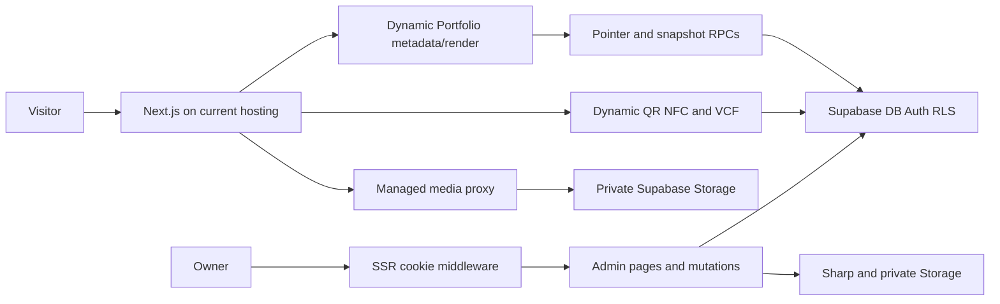

# Current application architecture

Audit date: 2026-10-30. Source: `230adeca680c0fe7e22b3ece0fd9169764b84ffe`, approved Main. Audit branch/worktree: `migration-architecture` at `F:/projects/nextap-migration-architecture`. Foundation documentation only. See [codebase structure](codebase-structure.md), [target plan](../migration/migration-plan.md), [phase specification](../migration/migration-spec.md) and [status](../migration/migration-status.md).

## Evidence and scope

Owner direction recorded 2026-10-30: **Main is the source of truth that Staging will match.** The approved Main commit governs application code and intended schema; observed Staging or Production schema is evidence to compare against that intent, not an alternative authority. Staging alignment requires approved code promotion and reviewed forward migrations. Staging credentials, resource bindings, hostnames, Auth settings and sanitized test data remain environment-specific. No code, schema or data synchronization is authorized by this clarification.

**S** means verified in source at the baseline, not necessarily deployed. **E** means read-only environment evidence dated 2026-10-30. **H** is dated historical evidence with stated limitations. **P** is a proposal or target. **U** is unavailable evidence, not a negative finding.

Source inspection covers every first-party `src/app` route entry/action, `src/lib` domain, relevant React render/client and managed-image path, all ordered SQL migrations and security tests, package/lockfile, Next/Sentry/environment configuration, CI and test/script entry points. It excludes vendor files, build output, binary files, customer rows and secret values. Critical flows received semantic inspection; no browser, load or Cloudflare runtime was exercised.

The original checkout has unrelated edits and untracked research/spec inputs; they remain untouched. Relevant untracked prompt/spec/research documents were copied byte-for-byte into this worktree for provenance. The 2026-10-28 R2 spec is historical and superseded where it suggests a shared Worker, pointer RPC on ordinary requests, or Supabase public-media fallback. Later approved target is two app deployments and publish-time static HTML with zero ordinary Portfolio Supabase requests.

## Dependencies and architecture

S: The project is a Next.js App Router modular monolith. Manifest versions are in [package.json](../../package.json#L19); resolved lockfile versions are in [package-lock.json](../../package-lock.json#L3169): Next **15.5.28**, React/React DOM **19.1.1**, Sharp **0.35.5**, `@supabase/ssr` **0.10.0**, `@supabase/supabase-js` **2.100.1**, Sentry Next **11.6.0**, QRCode **1.5.4**, fflate **0.8.3**, TypeScript **5.9.2**, Vitest **4.1.12**. Some manifest ranges are caret ranges; the lockfile resolves them. Installed and deployed versions were not attested. There is no OpenNext/Wrangler/R2 config or separate Admin/Public application entry at baseline.

## Phase 1 source dependency verification

Read-only TypeScript import analysis in the Phase 1 worktree verified the draft Server Action closure (19 first-party src modules), its actual Admin draft POST transport closure (24), and the ordinary Public `/b/[slug]` page closure (22). The Admin path reaches `@supabase/ssr` through `src/lib/auth/owner.ts` and `src/lib/supabase/server.ts`, and reaches current Supabase RPC/Storage and Sharp work through `src/lib/supabase/contact-draft-persistence.ts` and `src/lib/media/resolve-contact-photo.ts`. The Public page reaches `@supabase/supabase-js` through `src/lib/business/public-publication.ts` and `src/lib/supabase/public.ts`, where it calls `get_publication_pointer`, `get_publication_snapshot` and the `get_published_page` fallback. Its managed-image component can make a separate request to `src/app/api/media/[...path]/route.ts`, which currently reads Supabase Storage through `src/lib/media/read-object.ts`.

These are source import closures, not emitted-bundle or deployment proofs. The `/b/[slug]` Supabase lookup is documented current behavior and is not a Phase 1 failure; removing the ordinary Portfolio read belongs to the later Public-delivery phase. Full paths and the source graph are in [codebase structure](codebase-structure.md#verified-phase-1-import-closures).

## Route and request inventory

| Route/source | Method/access | Data, cache and effects | Runtime constraint |
| --- | --- | --- | --- |
| `/`, `/demo`, `/403`, `/card/unavailable`, `/sentry-example-page` | GET; public except gated diagnostics | Static/demo content; unavailable state/validated serial; diagnostic event only when explicitly enabled | App Router candidate; preserve headers and state |
| `/login` and actions | GET, Server Action; anonymous sign-in then owner admission | Auth password, claims, `owner_users`; isolate-local rate limit | cookie/action/origin proof |
| `/auth/callback`, `/auth/signout` | GET code exchange; POST logout | Auth session cookies, redirects | cookie callback and cache behavior proof |
| `/admin`, layout and businesses list/new/[id]/preview | GET; owner/capability guards | RLS rows, cursor pages, draft preview, dashboard counts | Dynamic RSC; Admin deployment |
| `/admin/businesses/actions.ts` | Server Actions; capability per action | table changes; `update_business_page` legacy RPC, `publish_page`, `create_admin_page`, `reorder_page_sections`; `revalidatePath` | imports Node crypto; per-RPC transaction semantics |
| draft actions; `/api/admin/businesses/draft` | bounded same-origin POST plus actions | multipart/form-urlencoded body 512 KiB, draft 256 KiB; origin, claims, owner, local throttle; `save_contact_draft` expected revisions; optional publish | streaming/FormData/session/action proof |
| `/admin/cards` and batch details | GET; owner | batches/cards/pages/history; sensitive token inventory | no-store, Admin-only |
| `/admin/cards/export` and batch ZIP | GET; export capability | snapshot RPC, QR SVG, formula-safe CSV, sync fflate ZIP, max 1,000 cards, local budget | Buffer, CPU, memory limits |
| Admin card assignment/deletion/history APIs | POST, POST, GET; owner/capability and bounded | idempotent assignment, deletion preview/commit, history; RPC/audit | origin/form/redirect/no-store proof |
| `/api/admin/operations` | POST; owner/capability | batch/page/branch creation, activation and token issuance | Node crypto; transactional RPC |
| `/api/admin/businesses/contact-preview` | POST; owner/origin/body/rate checked | compiles submitted contact, checks page, may write private crop derivative | Buffer, FormData, Sharp |
| `/api/admin/media` | POST; media capability and body/origin/business checks | Sharp transform, private Storage, metadata and contact JPEG | explicit Node runtime; redesign native image processing |
| `/api/media/[...path]` | GET; published allowlisted item or owner session | RLS-backed private Storage, bounded read; published max-age 60, private no-store, Vary Cookie | explicit Node runtime |
| `/b/[slug]` | dynamic GET plus metadata; public | pointer RPC then snapshot RPC; cached immutable snapshot, 5-second fallback and process map; images may hit Storage | existing behavior; fails only the later Public-delivery zero-Supabase target |
| `/b/[slug]/contact.vcf` | GET/HEAD; public/live eligibility | `get_published_page`, contact enabled/version, optional bounded private photo, no-store | allowed narrow live exception |
| `/c/[token]` | GET; public | token validate, `resolve_card`, preserves `via=qr|nfc`, no-store/no-referrer, local budget | allowed narrow live exception |
| `/c/[token]/contact.vcf` | GET/HEAD; live card eligibility | `get_card_contact` and optional photo; no-store/noindex | narrow exception |
| `/api/deployment` | GET; restricted preview only | allowlisted commit/branch/deployment identity, no-store | Vercel-specific and replaceable |
| `/api/sentry-example-api` | GET; disabled by default, owner/rate if enabled | controlled test error/flush; no-store | declared Node; exclude from Public |
| `src/middleware.ts` matches Admin, login, auth, Admin APIs | every match; no public /b or /c | Supabase SSR claim check and refreshed cookie/header propagation | Edge-default middleware; adapter support proof |

The table above is a compact summary. The method-level inventory below identifies every first-party page, route-handler method, Server Action module and middleware matcher found under `src/app` and `src/middleware.ts`, then records the shared layout/error/loading boundaries. It does not enumerate each UI control.

| Route | Method and access | Data, storage, transform, cache, side effect, or runtime | Source |
| --- | --- | --- | --- |
| `/` | GET, public | Home/demo-selection UI; no business DB read | [page](../../src/app/page.tsx#L33) |
| `/demo` | GET, public | Fixed illustrative snapshot; no DB read | [page](../../src/app/demo/page.tsx#L31) |
| `/403` | GET, public | Access-denied content | [page](../../src/app/403/page.tsx#L4) |
| `/card/unavailable` | GET, public | Validates and displays unavailable state/serial; no card lookup | [page](../../src/app/card/unavailable/page.tsx#L4) |
| `/sentry-example-page` | GET, diagnostic-gated | Controlled telemetry UI; no ordinary product route | [page](../../src/app/sentry-example-page/page.tsx#L6) |
| `/login` | GET; anonymous Server Action | Password sign-in, verified claims, `owner_users` admission, isolate-local rate limit; sets Auth cookies | [page](../../src/app/login/page.tsx#L6), [actions](../../src/app/login/actions.ts#L1) |
| `/auth/callback` | GET, anonymous callback | Exchanges code, establishes session cookie and redirects to allowlisted path | [handler](../../src/app/auth/callback/route.ts#L3) |
| `/auth/signout` | POST, current session | Signs out and clears Auth cookies; redirect/no-store behavior | [handler](../../src/app/auth/signout/route.ts#L3) |
| `/admin` | GET, owner/capability | Dashboard reads business/page state and counts; dynamic RSC, private/no-store | [page](../../src/app/admin/page.tsx#L4), [layout](../../src/app/admin/layout.tsx#L4) |
| `/admin/businesses` | GET, owner | RLS-protected business list and cursor pagination | [page](../../src/app/admin/businesses/page.tsx#L6) |
| `/admin/businesses/new` | GET, owner/capability | New business/branch setup and server action | [page](../../src/app/admin/businesses/new/page.tsx#L6) |
| `/admin/businesses/[id]` | GET, owner/capability | Loads editor business/page/sections; draft revisions and private preview | [page](../../src/app/admin/businesses/%5Bid%5D/page.tsx#L14) |
| `/admin/businesses/[id]/preview` | GET, owner/capability | Draft preview; may reference owner-only media; force-dynamic | [page](../../src/app/admin/businesses/%5Bid%5D/preview/page.tsx#L5) |
| Admin business Server Actions | POST, authenticated action transport; action-specific capability | Legacy save calls `update_business_page`; create/publish/reorder workflows call RPCs; `revalidatePath` is local Next invalidation, not distributed revocation | [actions](../../src/app/admin/businesses/actions.ts#L1), [draft actions](../../src/app/admin/businesses/draft-actions.ts#L1) |
| `POST /api/admin/businesses/draft` | Owner session, same-origin/origin check, bounded body | Multipart/form-urlencoded <=512 KiB; draft <=256 KiB; claim/owner check, local throttle, expected-revision `save_contact_draft`; optional publish | [handler](../../src/app/api/admin/businesses/draft/route.ts#L15) |
| `POST /api/admin/businesses/contact-preview` | Owner session, origin/body/rate checked | Validates contact and page; may create private contact-photo derivative | [handler](../../src/app/api/admin/businesses/contact-preview/route.ts#L7) |
| `POST /api/admin/media` | Media capability; owner, origin, size and business checked | FormData upload, Sharp transform, private Supabase Storage write and media metadata; Node runtime | [handler](../../src/app/api/admin/media/route.ts#L9) |
| `/admin/cards` | GET, owner | Filtered batch/card inventory and status; private/no-store | [page](../../src/app/admin/cards/page.tsx#L15) |
| `/admin/cards/batches/[id]` | GET, owner | Batch assignment/history and token inventory | [page](../../src/app/admin/cards/batches/%5Bid%5D/page.tsx#L9) |
| `GET /admin/cards/export` | Export capability | Reads protected batch snapshot; QR SVG and formula-safe CSV; rate-limited | [handler](../../src/app/admin/cards/export/route.ts#L12), [snapshot](../../src/lib/cards/batch-snapshot.ts#L1) |
| `GET /admin/cards/batches/[id]/manufacturing.zip` | Export capability | Synchronous fflate ZIP of QR/manufacturing assets, maximum 1,000 cards; CPU/memory bounded | [handler](../../src/app/admin/cards/batches/%5Bid%5D/manufacturing.zip/route.ts#L7), [builder](../../src/lib/cards/card-manufacturing.ts#L1) |
| `POST /api/admin/operations` | Owner/capability, bounded mutation | Batch/page/branch creation, activation and token issuance through RPCs | [handler](../../src/app/api/admin/operations/route.ts#L7) |
| `POST /api/admin/cards/assignment` | Owner/capability, origin/body checked | Idempotent assignment/disable RPC and audit trail | [handler](../../src/app/api/admin/cards/assignment/route.ts#L9) |
| `POST /api/admin/cards/deletion` | Owner/capability, acknowledged commit | Preview/commit RPC and receipt; bounded and no-store | [handler](../../src/app/api/admin/cards/deletion/route.ts#L4) |
| `GET /api/admin/cards/[id]/history` | Owner/capability | Paginated card history RPC/table read; no-store | [handler](../../src/app/api/admin/cards/%5Bid%5D/history/route.ts#L8) |
| `GET /api/media/[...path]` | Anonymous published allowlisted object or owner session | RLS-backed private Storage read, bounded bytes; published max-age 60, private no-store and Vary: Cookie; Node runtime | [handler](../../src/app/api/media/%5B...path%5D/route.ts#L6) |
| `GET /b/[slug]` and metadata | Public, force-dynamic | Pointer RPC then snapshot RPC; immutable snapshot cache plus 5-second fallback/process map; managed images may call Storage route | [page](../../src/app/b/%5Bslug%5D/page.tsx#L6), [lookup](../../src/lib/business/public-publication.ts#L15) |
| `GET/HEAD /b/[slug]/contact.vcf` | Public, live contact eligibility | `get_published_page`, enabled/version check; optional bounded private photo; no-store/noindex | [handler](../../src/app/b/%5Bslug%5D/contact.vcf/route.ts#L3), [download](../../src/lib/business/contact-download.ts#L8) |
| `GET /c/[token]` | Public, syntactically valid token | Live `resolve_card`; zero-body 302, no-store/no-referrer, preserves QR/NFC marker; isolate-local rate limit | [handler](../../src/app/c/%5Btoken%5D/route.ts#L19) |
| `GET/HEAD /c/[token]/contact.vcf` | Public, current active-card/contact eligibility | Live `get_card_contact`; optional private photo; no-store/noindex | [handler](../../src/app/c/%5Btoken%5D/contact.vcf/route.ts#L3), [download](../../src/lib/business/contact-download.ts#L8) |
| `GET /api/deployment` | Preview-only diagnostic | Allowlisted Vercel commit/branch/deployment identity; no-store | [handler](../../src/app/api/deployment/route.ts#L7) |
| `GET /api/sentry-example-api` | Disabled by default; owner/rate gate when enabled | Controlled event/flush test; Node runtime; exclude from Public | [handler](../../src/app/api/sentry-example-api/route.ts#L7) |
| Middleware matcher: `/admin/:path*`, `/login`, `/auth/:path*`, `/api/admin/:path*` | Runs for every matching method/request; public `/b` and `/c` excluded | Supabase SSR `getClaims`; refreshed cookies copied to request and response with headers; default Next middleware runtime | [matcher](../../src/middleware.ts#L5), [cookie proxy](../../src/lib/supabase/proxy.ts#L4) |

| Shared boundary | Method/access and scope | Data, cache, side effect or runtime | Source |
| --- | --- | --- | --- |
| Root App Router layout | Wraps page renders; no independent endpoint or authorization | Sets Arabic RTL document and shared title/Open Graph metadata; `NEXT_PUBLIC_SITE_URL` supplies metadata base; no application DB/storage read | [layout](../../src/app/layout.tsx#L4) |
| Not-found boundary | Framework 404 for unresolved routes; originating route's access policy applies | Fixed recovery links; no DB/storage read or mutation; framework response status | [not-found](../../src/app/not-found.tsx#L4) |
| Public error boundaries | Segment errors and root-layout failures; no independent endpoint | Client fallback/retry and sanitized Sentry exception capture; no application DB/storage read; client runtime | [segment error](../../src/app/error.tsx#L8), [global error](../../src/app/global-error.tsx#L6), [client capture](../../src/lib/observability/client.ts#L4) |
| Admin error boundary | Admin segment errors; inherits Admin middleware and route capability policy | Client fallback/retry and sanitized Sentry exception capture; no direct DB/storage operation; client runtime | [Admin error](../../src/app/admin/error.tsx#L7) |
| Admin business/card loading states | Render while protected descendant pages resolve; inherit Admin middleware and route capability policy | Loading UI only; no independent query, write or cache policy; App Router streaming behavior requires Worker proof | [businesses](../../src/app/admin/businesses/loading.tsx#L1), [cards](../../src/app/admin/cards/loading.tsx#L1) |

## Public rendering, publishing and media

S: [page.tsx](../../src/app/b/%5Bslug%5D/page.tsx#L6) is force-dynamic. `generateMetadata` and body call `getPublicPublication`. [public-publication.ts](../../src/lib/business/public-publication.ts#L15) queries `get_publication_pointer`, then immutable `get_publication_snapshot` via `unstable_cache(revalidate:false)`; fallback `get_published_page` cache is five seconds. Missing-pointer capability is remembered per isolate. React `cache` and a bounded five-second process-local map coalesce page/metadata requests. Cold, expired, miss/error and fallback paths still contact Supabase; these caches do not meet zero-request architecture or establish cross-colo visibility bounds. A pending promise can outlive nominal freshness.

[PublicSnapshot](../../src/components/business/public-snapshot.tsx#L135) renders hero, About, hours, gallery, social, payments, contact, maps and actions from snapshot. About is in that document, not a separate fetch. Client interactions and `next/image` remain. [ManagedImage](../../src/components/business/managed-image.tsx#L1) points managed URLs at `/api/media`. That handler reads the private Supabase Storage bucket anonymously under its publication RLS policy or retries as an owner session. Framework CSS/JS/font/image requests also matter. The target renderer must avoid request-time Next/RSC rendering and browser Supabase access while retaining current content, metadata, accessibility and interactions.

The [dated public-media investigation](../research/PUBLIC_PROFILE_MEDIA_AND_PERFORMANCE.md) found a published cover 404, a supplied 12,687-byte AVIF transformed to around 43-46 kB, four font bodies at 129,608 bytes and ten JS bodies at 151,414 bytes. This is one trace, not a repeated cold baseline or field distribution; cover failure affects LCP. It does not establish a universal compression ratio or About fetch problem.

S: Draft transport is bounded multipart/form-urlencoded POST. Parser bounds sections/items/text/provider/contact. `save_contact_draft` locks expected page/business revisions and persists draft plus optional immutable publication in a Postgres transaction ([migration](../../supabase/migrations/20261020063654_contacts.sql#L101)). Contact-photo derivative preparation can precede the transaction. Snapshot rows are immutable/versioned, pointers select visible revision, slug aliases preserve renames. Next revalidation does not itself prove distributed revocation. R2 and Postgres will not share a transaction.

S/E: Legacy [saveBusiness](../../src/app/admin/businesses/actions.ts#L47) calls `update_business_page`. The current contact-editor path instead calls `save_contact_draft`, so the missing legacy RPC does not prove all saves fail. Read-only catalog inspection found Staging lacks seven-argument `public.update_business_page`, while Production has it; Staging ledger also lacks `legacy_relationship_guards`. The two ledgers each contain 31 entries, but names/versions differ. Treat the missing RPC as Staging drift to reconcile against approved Main schema intent, including the exact function signature, authorization, grants and migration history. Production presence alone is not the schema specification. Use a reviewed forward migration after execution approval; do not edit applied migrations, copy environment definitions blindly or copy rows.

### Media privacy and AVIF

S: Upload and crop/preview use native Sharp and private `business-media` Storage; paths are UUID scoped. Upload checks media capability/business and bounds body before transforming. Public-media migration registers paths extracted from active snapshots in `private.publication_media` and restricts bucket reads. `/api/media` uses RLS for anonymous published bytes and owner session for private content; responses are bounded and cookie-varying.

**AVIF blocker (S/E):** `snapshot_media_paths` filters WebP/PNG/JPEG/contact JPEG, not AVIF ([migration](../../supabase/migrations/20261024021635_publication_media_privacy.sql#L12)). Later `allow_avif_business_media` migration only modifies MIME types/bucket acceptance. Catalog query on 2026-10-30 found identical function hash in both projects and no AVIF term. Plan forward SQL and controlled eligible-reference registration/republish; do not widen bucket policies or execute repairs now.

## Auth, QR/NFC, VCF

[Middleware](../../src/middleware.ts#L5) covers Admin/login/auth/Admin APIs only. [Supabase proxy](../../src/lib/supabase/proxy.ts#L4) uses SSR cookies, `getClaims`, propagates updated request/response cookies and headers. [requireOwner](../../src/lib/auth/owner.ts#L5) checks verified identity and owner admission then capability RPC. This is global internal staff access, not customer tenant isolation; RLS/triggers/RPC guards are authoritative. Auth cookies, callback allowlists and provider settings were not inspected.

`/c/[token]` validates token, resolves current card assignment live and sends no-store 302/no-referrer to relative profile URL, preserving only QR/NFC marker. Invalid/inactive/unassigned outcomes remain distinct; no synchronous visit insert. Rate limiter is process-local, not a global security limit. Card QR/NFC origin is hard-coded to `nextap.services` for hosted use. Manufacturing uses QRCode SVG, formula-injection-safe CSV, sanitized serial filenames and fflate ZIP of at most 1,000 items; sync archive CPU/memory need proof.

VCF GET/HEAD validates identity and checks live `get_published_page`/`get_card_contact` eligibility every time. Disabled contact is 404. GET may fetch bounded precomputed private JPEG; HEAD skips photo. No-store/noindex/no-referrer, UTF-8 folding and output byte caps are implemented in [contact download](../../src/lib/business/contact-download.ts#L8) and [serializer](../../src/lib/business/vcard.ts#L5). Keep private contact/photo out of immutable public artifacts.

## Database and hosted evidence

S: Eleven public tables: owner_users, businesses, business_pages, page_sections, page_publications, page_slug_aliases, card_batches, cards, card_assignment_history, media_assets, audit_logs ([initial schema and RLS](../../supabase/migrations/202610080001_initial_schema.sql#L5), [slug aliases](../../supabase/migrations/202610080002_publish_and_slugs.sql#L1)). Private tables track admissions, retained publication media, receipts, deletions, issuance and serials ([capabilities](../../supabase/migrations/20261024020834_internal_admin_capabilities.sql#L3), [inventory operations](../../supabase/migrations/20261014210855_admin_inventory_operations.sql#L8), [media privacy](../../supabase/migrations/20261024021635_publication_media_privacy.sql#L2)). Immutable publications, FKs, optimistic revisions, ordering, token/serial rules and RLS are behavior dependencies. Public wrappers commonly use SECURITY INVOKER; selected private functions SECURITY DEFINER. `save_contact_draft` is a public SECURITY DEFINER exception with explicit capability/revision checks ([definition and grants](../../supabase/migrations/20261020063654_contacts.sql#L101)). Grants and RLS are separate controls. Capability migration creates restrictive policies/triggers and operator-managed admissions ([policies](../../supabase/migrations/20261024020834_internal_admin_capabilities.sql#L78)).

### Application RPC inventory

S: Static source scan of every `.rpc` call found this complete application call-site set. Direct table and Storage operations remain separately authorized by RLS and grants.

| RPCs | Caller and purpose | Authorization/transaction boundary |
| --- | --- | --- |
| `get_publication_pointer`, `get_publication_snapshot`, `get_published_page` | Portfolio slug/pointer/snapshot and VCF contact projection | Anon/authenticated read wrappers; current `/b` invokes pointer and snapshot plus compatibility fallback |
| `resolve_card` | `/c` token redirect | Anon/authenticated narrow current-card resolution; no visit write |
| `get_card_contact` | Card VCF | Anon/authenticated narrow enabled-contact projection |
| `admin_has_capability` | `requireOwner` for privileged Admin operations | Authenticated wrapper; private admission/capability check |
| `save_contact_draft` | Current editor save/publish | Authenticated only; expected revisions and draft/optional publication in one PostgreSQL transaction |
| `update_business_page` | Legacy direct business/page save | Authenticated only; absent in Staging, present in Production; current editor uses `save_contact_draft` |
| `publish_page` | Legacy/direct publication action | Authenticated only with internal publish capability; publication/pointer mutation in SQL |
| `reorder_page_sections` | Admin section ordering | Authenticated atomic SQL operation |
| `create_admin_page` | Admin business/branch creation | Authenticated capability and idempotency receipt in SQL |
| `create_card_batch` | Admin batch creation | Authenticated idempotent SQL creation; tokens enter protected Admin inventory |
| `card_batch_snapshot` | Admin manufacturing export | Authenticated export capability; anon denied |
| `assign_card`, `assign_card_once` | Card assignment/disable | Authenticated capability; once variant uses idempotency key |
| `preview_card_deletion`, `commit_card_deletion` | Admin deletion impact/commit | Authenticated capability and acknowledgment; preview/receipt constrain commit |
| `save_page_draft` | Historical compatibility contract | Migration history contains it, but source scan found no current caller; migration presence alone does not prove use |

Caller and SQL-definition anchors for the inventory:

| RPC family | Application caller | SQL definition/grant |
| --- | --- | --- |
| `get_publication_pointer`, `get_publication_snapshot`, `get_published_page` | [public-publication.ts](../../src/lib/business/public-publication.ts#L15), [contact-download.ts](../../src/lib/business/contact-download.ts#L39) | [publication pointer/snapshot](../../supabase/migrations/20261010122933_phase6_publication_cache.sql#L22), [base reader](../../supabase/migrations/202610080001_initial_schema.sql#L140) |
| `resolve_card`, `get_card_contact` | [card redirect](../../src/app/c/%5Btoken%5D/route.ts#L31), [contact download](../../src/lib/business/contact-download.ts#L38) | [base resolve](../../supabase/migrations/202610080001_initial_schema.sql#L142), [contact wrapper/grant](../../supabase/migrations/20261020063654_contacts.sql#L122) |
| `admin_has_capability` | [owner.ts](../../src/lib/auth/owner.ts#L20) | [capability policy migration](../../supabase/migrations/20261024020834_internal_admin_capabilities.sql#L40) |
| `save_contact_draft`, `update_business_page`, `publish_page`, `reorder_page_sections` | [draft actions](../../src/app/admin/businesses/draft-actions.ts#L17), [business actions](../../src/app/admin/businesses/actions.ts#L51) | [contact contract](../../supabase/migrations/20261020063654_contacts.sql#L101), [legacy forward definition/grant](../../supabase/migrations/20261024010000_legacy_relationship_guards.sql#L32), [publish grants](../../supabase/migrations/202610080003_publish_page.sql#L26), [reorder](../../supabase/migrations/202610080007_atomic_section_reordering.sql#L1) |
| `create_admin_page`, `create_card_batch`, `card_batch_snapshot` | [business actions](../../src/app/admin/businesses/actions.ts#L110), [batch snapshot](../../src/lib/cards/batch-snapshot.ts#L7) | [operations/grants](../../supabase/migrations/20261014210855_admin_inventory_operations.sql#L89), [snapshot/grant](../../supabase/migrations/20261024020834_internal_admin_capabilities.sql#L113) |
| `assign_card`, `assign_card_once`, `preview_card_deletion`, `commit_card_deletion` | [assignment](../../src/app/api/admin/cards/assignment/route.ts#L26), [deletion](../../src/app/api/admin/cards/deletion/route.ts#L17) | [inventory functions/grants](../../supabase/migrations/20261014210855_admin_inventory_operations.sql#L118) |
| `save_page_draft` historical contract | No current source caller found | [migration contract/grants](../../supabase/migrations/20261010042706_unambiguous_provider_draft_contract.sql#L7) |

SQL definitions and grants are distributed across initial schema, publication, card, incremental-save, contact, internal-capability, inventory and launch-security migrations. Inspect final deployed definitions, not only the oldest migration. Live privilege results above cover selected functions, not every signature.

Direct PostgREST table operations are concentrated in owner admission, Admin dashboard/business/card pages and actions, operations APIs, media metadata and preview workflows ([owner admission](../../src/lib/auth/owner.ts#L10), [business actions](../../src/app/admin/businesses/actions.ts#L20), [card inventory](../../src/app/admin/cards/page.tsx#L42), [media storage](../../src/lib/media/store.ts#L9), [contact photo resolution](../../src/lib/media/resolve-contact-photo.ts#L12)). Storage uses the private `business-media` bucket; upload writes metadata and object bytes, while published/private reads pass the media route and RLS policy. Browser interactions upload through Admin handlers rather than receiving a privileged client. Table grants, row policies and function EXECUTE grants are independent gates.

E: On 2026-10-30, read-only catalog queries checked RLS flags, selected function grants/definition hashes, migration ledgers and database version/size on known Staging/Production refs. All eleven public tables and two sampled private tables had RLS enabled. Sampled public page/card/contact functions allow anon/authenticated; publish/draft-save/card-assignment sampled functions deny anon and allow authenticated with in-function authorization. Staging-only `public.rls_auto_enable()` is SECURITY DEFINER and not executable by anon/authenticated. Both report Postgres 17.11 and 31 ledger entries with different history. Database sizes were approximately 18.9 MB and 14.5 MB; earlier project metadata reports healthy eu-west-1. This is selected catalog evidence, not effective-role penetration testing, usage/billing, backup or full schema parity. No application data was selected.

## Runtime, CI and deployment configuration

S: [environment.mjs](../../src/lib/config/environment.mjs#L10) enforces approved Staging/Production project mapping and rejects unknown/conflicting targets, unsafe URLs and secret-shaped public key. Adapt this guard to immutable Worker identity; never fall through because Vercel vars disappear. Public-origin helper currently assumes one origin. Split Admin host/CSRF/callback from canonical profile/card host; host-only cookies by default.

`next.config.ts` configures CSP, HSTS, nosniff, frame/referrer/permissions, private Admin/card caching, image host and Sentry build. Source maps upload only with build auth and are deleted from artifacts; release fallback uses Vercel SHA. Instrumentation selects Node/Edge Sentry and sanitizes URLs/events. Static R2 HTML needs explicit CSP, cache, canonical/OG and other headers; these Next config rules do not apply automatically.

CI on PR/Main/Staging performs npm audit, lint, typecheck, unit tests, disposable database contract/concurrency suites, production Next build and public desktop/mobile smoke. Protected Staging hosted E2E can be invoked by staging push or manual dispatch; explicit mutation flag seeds synthetic Staging records. A Next build is not Worker runtime proof. Current provider auto-deploy/branch and Cloudflare plan are unavailable; historical handoffs are not live account evidence.

E: Earlier read-only public DNS lookup returned Hostinger parking nameservers `helios.dns-parking.com` and `aster.dns-parking.com` for `nextap.services`. This is delegation evidence only. Source and current direction use nextap.services; nextapp.services/nextab.services are conflicting historical labels. No provider or DNS changes made.

Environment variable inventory (names only; values are omitted):

| Scope | Names and use | Evidence |
| --- | --- | --- |
| Application config/runtime | `NEXTAP_ENV`, `NEXT_PUBLIC_SUPABASE_URL`, `NEXT_PUBLIC_SUPABASE_PUBLISHABLE_KEY`, `NEXT_PUBLIC_SITE_URL`, `NEXT_PUBLIC_CONTACT_WHATSAPP`, `NEXT_PUBLIC_WALLET_USSD_ENABLED`, `NEXTAP_ALLOW_DYNAMIC_PUBLIC_ORIGIN`, `NEXTAP_BUILD_DIR`, `NODE_ENV`, `NEXT_RUNTIME`. Public Supabase URL and publishable key are browser-visible and rely on RLS; public-origin/contact/wallet values can be inlined into the browser build. | [example names](../../.env.example#L2), [environment guard](../../src/lib/config/environment.mjs#L10), [public origin](../../src/lib/security/public-origin.ts#L14), [build config](../../next.config.ts#L5), [wallet flag](../../src/lib/config/wallet-ussd.mjs#L7), [runtime instrumentation](../../src/instrumentation.ts#L3) |
| Observability/build | `SENTRY_DSN`, `NEXT_PUBLIC_SENTRY_DSN`, `SENTRY_ENVIRONMENT`, `NEXT_PUBLIC_SENTRY_ENVIRONMENT`, `SENTRY_RELEASE`, `NEXT_PUBLIC_SENTRY_RELEASE`, `SENTRY_ENABLED`, `NEXT_PUBLIC_SENTRY_ENABLED`, `SENTRY_TEST_ERRORS_ENABLED`, `SENTRY_AUTH_TOKEN`, `SENTRY_ORG`, `SENTRY_PROJECT`, `SENTRY_URL`, `NEXT_PUBLIC_VERCEL_GIT_COMMIT_SHA`, `VERCEL_GIT_COMMIT_SHA`, `GITHUB_SHA`. Client-prefixed settings are browser-visible/build-time; server DSN and release settings configure runtime telemetry; Sentry auth is build-only for source-map upload. | [example names](../../.env.example#L9), [Sentry runtime policy](../../src/lib/observability/sentry.ts#L6), [build/source maps](../../next.config.ts#L38) |
| Hosting/CI identity | `VERCEL_ENV`, `VERCEL_URL`, `VERCEL_DEPLOYMENT_ID`, `VERCEL_GIT_COMMIT_REF`, `CI`, `GITHUB_REF_NAME`, `GITHUB_REPOSITORY`, `GITHUB_EVENT_PATH`, `GITHUB_STEP_SUMMARY`, `GITHUB_TOKEN`, `SELF_REVIEW_OUTPUT`. These identify build/test/deployment context or GitHub automation; they do not establish Cloudflare account or deployment state. | [environment guard](../../src/lib/config/environment.mjs#L10), [deployment diagnostic](../../src/app/api/deployment/route.ts#L7), [CI workflow](../../.github/workflows/ci.yml#L3), [`self-review.mjs`](../../scripts/ci/self-review.mjs#L255) |
| E2E/measurement tooling | `E2E_ALLOW_MUTATIONS`, `E2E_BASE_URL`, `E2E_CONTACT_BRANCH_PAGE_ID`, `E2E_CONTACT_BUSINESS_ID`, `E2E_CONTACT_MAIN_PAGE_ID`, `E2E_FIXTURE_JSON`, `E2E_FIXTURE_PATH`, `E2E_KEEP_RELIABILITY_FIXTURE`, `E2E_SERVER_MODE`, `E2E_USER_OWNER_USERNAME`, `E2E_USER_OWNER_PASSWORD`, `E2E_USER_NON_OWNER_USERNAME`, `E2E_USER_NON_OWNER_PASSWORD`, `VERCEL_AUTOMATION_BYPASS_SECRET`, `AUDIT_FIXTURE_PATH`, `AUDIT_LIGHTHOUSE_MODULE`, `OPTIMIZATION_BASE_URL`, `RELIABILITY_BASE_URL`. These are test/operator inputs; credentials and bypass values are protected inputs, while fixture identifiers/data must be synthetic and sanitized. | [hosted workflow](../../.github/workflows/hosted-e2e.yml#L3), [hosted inputs](../../.github/workflows/hosted-e2e.yml#L49), [preflight](../../scripts/ci/hosted-staging-preflight.mjs#L14), [measurement scripts](../../scripts/observability/observability-baseline.mjs#L14) |

`NEXT_PUBLIC_*` is not a secret boundary. `.github/workflows/ci.yml` runs on pull requests and pushes to Main/Staging and supplies build/test inputs ([triggers](../../.github/workflows/ci.yml#L3), [job environment](../../.github/workflows/ci.yml#L22)). The hosted E2E workflow runs on Staging pushes or manual dispatch; seed mutations require the explicit input and are followed by a deployment-only preflight ([triggers](../../.github/workflows/hosted-e2e.yml#L3), [mutation gate](../../.github/workflows/hosted-e2e.yml#L64)). Current Provider auto-deploy triggers remain unavailable. Admin publish and Public read R2 bindings do not exist.

## Worker compatibility matrix

Source classification, not compatibility certification. See [official evidence checked 2026-10-30](../research/CLOUDFLARE_WORKERS_PLATFORM_EVIDENCE.md). Read-only npm registry check found OpenNext 1.20.14, peer range `>=15.5.28 <16 || >=16.4.1` and Wrangler peer ^4.148.0; Wrangler latest 4.156.0. Proposed proof pins candidates, current Next and compatibility date 2026-10-30. Nothing installed. Runtime defaults changed 2026-08-04; older Node compatibility examples differ.

| Used feature | Classification/work | Required Staging proof |
| --- | --- | --- |
| App Router, RSC, routes/layouts | Adapter candidate; prove each route | workerd render/navigation with exact pins |
| Server Actions | origin/cookie/config proof | login, draft, stale revisions, errors, fallback, redirects |
| Middleware | existing Edge default; adapter caveat | refreshed cookies/headers; Public bypass |
| Route handlers, streams, Buffer/crypto | mixed Web/Node surface | GET/HEAD/POST, body bounds, crypto, VCF bytes |
| Supabase SSR/Auth/RPC | JS candidate, no adapter certification | callbacks/refresh/logout; role-negative tests |
| Sharp image processing | redesign; native addon unproven | selected processor passes format/size/orientation/metadata/privacy |
| Browser crop | browser-only; server authoritative | mobile and hostile payload limits |
| Next Image | config/code change | prebuilt variants and native img/srcset; zero Public DB/media request |
| unstable_cache and isolate map | remove ordinary public dependency | cold/warm/miss/error path no RPC and bounded visibility |
| PublicSnapshot to artifact | new publish-time renderer | standalone HTML, metadata, URL/escape validation, RTL/a11y |
| QR/CSV/ZIP | API candidate, CPU/memory risk | decode artifacts; 1/1,000-card resource bound |
| VCF | Buffer proof, live exception | eligibility, no-store GET/HEAD and private photo checks |
| Sentry/maps/headers | integration-specific config | release correlation, sanitized telemetry, maps private, static CSP |
| R2 artifacts/media | new infrastructure | Public provider read-only, Admin write scope, immutable verified output |

Cloudflare currently recommends beta vinext for new apps. OpenNext is the conservative existing-Next proof candidate because its peer range includes installed Next 15.5.28. Repository counts on audit date (~9,274 vinext, ~1,911 OpenNext stars) do not certify parity. OpenNext app compatibility is unproven; Sharp is a concrete blocker, and nodejs_compat does not prove native addons.

### Compatibility evidence by feature

The summary above is expanded here to show source use, explicit classification, first-party platform evidence, required change, and a measurable Staging gate. Unless a row says otherwise, compatibility is unproven until the exact versions are built and exercised in workerd and deployed Staging.

| Source/use | Classification and required change | Official compatibility evidence | Staging proof and pass criteria |
| --- | --- | --- | --- |
| App Router/RSC/layouts/metadata: [Portfolio](../../src/app/b/%5Bslug%5D/page.tsx#L6), [Admin](../../src/app/admin/page.tsx#L4) | **API-compatible; Worker proof required.** Keep Admin RSC at its boundary; create standalone publish-time Public HTML. | [Cloudflare OpenNext](https://developers.cloudflare.com/workers/framework-guides/web-apps/opennext/), [Next 15 routing](https://nextjs.org/docs/15/app/getting-started/route-handlers-and-middleware); neither certifies this app's route closure. | Exact-pin deployed routes, metadata, 404/error, no missing assets or Admin leakage. |
| Server Actions: [business](../../src/app/admin/businesses/actions.ts#L1), [login](../../src/app/login/actions.ts#L1) | **Adapter-dependent/unproven.** Preserve POST, origin, redirect, session, action-key isolation and revision behavior. | [OpenNext setup](https://opennext.js.org/cloudflare/get-started) documents configuration but no parity guarantee for these contracts. | Login/logout/save/publish/stale revision/replay/origin denial/error all pass on isolated Worker. |
| Middleware/cookies: [matcher](../../src/middleware.ts#L5), [proxy](../../src/lib/supabase/proxy.ts#L4) | **Code/adapter change; unproven.** Existing default Edge middleware must be proven or session refresh redesigned at a supported boundary. | [Cloudflare OpenNext guide](https://developers.cloudflare.com/workers/framework-guides/web-apps/opennext/) reports Node middleware from Next 15.2 unsupported; [OpenNext setup](https://opennext.js.org/cloudflare/get-started) says Edge runtime is unsupported. | Expired-claim refresh propagates request/response cookies and headers; protected routes deny correctly; Public never receives cookies. |
| Route handlers/methods: [Admin API](../../src/app/api/admin/operations/route.ts#L7), [VCF](../../src/app/c/%5Btoken%5D/contact.vcf/route.ts#L3) | **Web API compatible; Worker proof required.** Preserve method/status/header/body/abort semantics and runtime declarations. | [Next 15 Route Handlers](https://nextjs.org/docs/15/app/getting-started/route-handlers-and-middleware), [Workers limits](https://developers.cloudflare.com/workers/platform/limits/). | GET/HEAD/POST, empty redirect, VCF bytes, errors and body caps match existing contracts. |
| Node APIs/streams/Buffer/crypto: [media route](../../src/app/api/media/%5B...path%5D/route.ts#L6), [ZIP](../../src/lib/cards/card-manufacturing.ts#L1) | **Partial compatibility; code change/unproven.** Inventory Node-only imports and methods; replace unsupported calls. | [Node compatibility](https://developers.cloudflare.com/workers/runtime-apis/nodejs/) is a subset and includes throwing stubs; [limits](https://developers.cloudflare.com/workers/platform/limits/). | Every production import executes in workerd without stubs, filesystem assumptions, body overrun or memory overflow. |
| Static generation and dynamic R2 artifacts: [currently dynamic page](../../src/app/b/%5Bslug%5D/page.tsx#L6) | **Code change.** Generate allowlisted standalone HTML at publish time; deploy assets are not dynamic R2 data. | [Worker static assets](https://developers.cloudflare.com/workers/static-assets/) are deployed with code; [R2 custom domains](https://developers.cloudflare.com/r2/buckets/public-buckets/) deliver bucket objects. | HTML persists across Worker deploy and DB outage; fetch causes zero Supabase calls and no request-time business rendering. |
| Streaming/Suspense/loading: [Admin loading](../../src/app/admin/loading.tsx#L1) | **Adapter-dependent/unproven.** Public artifact does not depend on streaming; keep Admin streaming only if proven. | OpenNext documentation does not certify this route's stream timing; framework behavior alone is not Worker evidence. | Slow synthetic backend validates flush/backpressure/cancellation with no partial sensitive response or buffered timeout regression. |
| Next cache/revalidation/process map: [publication lookup](../../src/lib/business/public-publication.ts#L25) | **Public redesign; Admin config/proof.** Remove from ordinary Public path; use one bounded publication freshness policy. | [OpenNext cache guidance](https://opennext.js.org/cloudflare/get-started), [known issues](https://opennext.js.org/cloudflare/known-issues); Cache API is colo-local. | Cold/warm/expiry/miss/negative/error/purge-failure tests show zero Public DB calls and measured visibility bound. |
| Supabase SSR/Auth: [server client](../../src/lib/supabase/server.ts#L1), [proxy](../../src/lib/supabase/proxy.ts#L1) | **Runtime candidate; combined adapter proof required.** Retain host-only cookies, callbacks, `getClaims`, RLS and environment guards. | [Supabase Next SSR](https://supabase.com/docs/guides/auth/server-side/nextjs); [supabase-js Cloudflare support](https://github.com/supabase/supabase-js#cloudflare-workers) is not full-stack certification. | Login/callback/refresh/logout/origin denial/anonymous and non-owner denial/cross-host isolation pass in Staging. |
| RPC/RLS/SQL transactions: [public calls](../../src/lib/business/public-publication.ts#L15), [draft transaction](../../supabase/migrations/20261020063654_contacts.sql#L101) | **Database contracts remain; Public request redesign.** Keep approved-Main schema authority and remove ordinary Portfolio RPCs. | [Supabase RLS docs](https://supabase.com/docs/guides/database/postgres/row-level-security); hosting does not alter Postgres transaction semantics. | Approved schema/grants, negative anon/non-owner tests, and exactly zero ordinary Portfolio Supabase requests. |
| Native Sharp: [optimizer](../../src/lib/media/optimize.ts#L1), [upload](../../src/app/api/admin/media/route.ts#L9) | **Native addon unproven/incompatible; redesign required.** Use supported WASM/Worker processing or an external Node processing capability; two Workers alone are insufficient if Sharp remains. | [Node compatibility](https://developers.cloudflare.com/workers/runtime-apis/nodejs/) does not provide arbitrary native addons; [WASM](https://developers.cloudflare.com/workers/runtime-apis/web-assembly/) and [Images transformation](https://developers.cloudflare.com/images/transform-images/transform-via-workers/) are alternatives with separate limits/privacy/cost. | JPEG/PNG/WebP/AVIF, orientation, animation, dimension/pixel bounds, metadata, crop, privacy, quality, CPU, memory and cost all pass. |
| Upload/body/browser crop: [body bound](../../src/lib/security/bounded-body.ts#L1), [image editor](../../src/app/admin/businesses/_components/image-field.tsx#L1) | **Configuration/code change.** Keep body and decoded-pixel limits before processing; app validation remains mandatory. | [Workers limits](https://developers.cloudflare.com/workers/platform/limits/), [R2 upload limits](https://developers.cloudflare.com/r2/platform/limits/). | Hostile/oversized/animated/malformed/interrupted/mobile uploads fail safely; valid crop writes expected private object and metadata. |
| Next Image/managed media: [component](../../src/components/business/managed-image.tsx#L1), [config](../../next.config.ts#L10) | **Code/config change.** Use precomputed variants and responsive `img/srcset` or a proven optimizer; no Public transformation or Supabase media request. | [Next Image docs](https://nextjs.org/docs/15/app/api-reference/components/image); the adapter does not certify this privacy/optimizer path. | Cover/logo/gallery load from media host with correct size/alt; no Next optimizer, DB, private URL or layout shift. |
| Sentry/source maps/security headers: [Next config](../../next.config.ts#L22), [instrumentation](../../src/instrumentation.ts#L1) | **Configuration/integration proof required.** Replace Vercel identity; keep auth token build-only and maps private/deleted; set Worker HTML headers explicitly. | [Sentry Cloudflare SDK](https://docs.sentry.io/platforms/javascript/guides/cloudflare/) documents a Worker integration, not this Next plugin/OpenNext pair. | Sanitized event has correct Worker release/environment; maps resolve privately and are absent from public output; CSP/security headers match policy. |
| QR/CSV/ZIP/VCF: [builder](../../src/lib/cards/card-manufacturing.ts#L1), [serializer](../../src/lib/business/vcard.ts#L1) | **API candidate; CPU/memory proof.** Keep CSV formula guard, output bounds, token privacy and live VCF eligibility. | Web APIs are subject to [Worker limits](https://developers.cloudflare.com/workers/platform/limits/); no adapter guarantee bounds this synchronous ZIP. | Decode outputs; compare 1 and 1,000-card resource ceilings; no token logs; VCF GET/HEAD remains live and no-store. |
| Environment guards/bindings: [environment guard](../../src/lib/config/environment.mjs#L10) | **Configuration/code change.** Bind immutable environment identity; missing, wrong or conflicting identity fails closed. | [Worker vars/secrets](https://developers.cloudflare.com/workers/configuration/environment-variables/) describe configuration, not project isolation. | Wrong IDs/URLs, leaked secrets, Public write/list attempt and missing bindings fail closed; exact per-environment identity is recorded. |
| CI/deployment identity: [workflow](../../.github/workflows/ci.yml#L3), [Vercel route](../../src/app/api/deployment/route.ts#L7) | **Configuration/code change.** Add pinned adapter/workerd validation only after approval; inspect automatic provider triggers before integration. | [OpenNext deployment setup](https://opennext.js.org/cloudflare/get-started); current workflow only builds Next. | Exact SHA produces reproducible Worker artifact; route manifest, compatibility date and bindings are recorded; no unapproved Production trigger. |

Cloudflare currently recommends beta vinext for new apps; that is not evidence it supports this Next 15.5.28 codebase. OpenNext is the existing-Next candidate because current npm peer metadata includes this exact Next version floor, but adapter parity is unproven. Repository star counts are not compatibility evidence. `nodejs_compat` does not prove native Sharp works. A successful Next build alone does not prove Worker compatibility.

## Confirmed gates and gaps

1. AVIF registration needs forward migration and safe re-registration.
2. Staging needs approved-Main schema/grant reconciliation for legacy update_business_page; no alignment has been applied.
3. Pin/test Worker adapter and standalone renderer; choose supported image processing.
4. Remove Supabase from ordinary public HTML, metadata, middleware, browser media and all error paths.
5. Enforce Public R2 read-only at provider binding/credential level; TS interfaces are not authorization.
6. Verify provider plan/usage, deployment triggers, Auth host/callback, backup/restore, mail/DNS/DNSSEC and Staging copy scope before execution.
