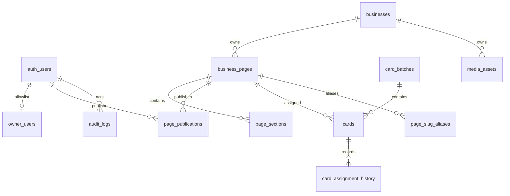

# NexTap schema, architecture, and capacity handoff

Audit date: 2026-10-12

Scope: read-only audit of the preproduction Supabase project `flkakuysakgwfoemgbwn` and the checked-out Next.js source at commit `1d97341` (`Improve business payment provider handling`). No application code, migration, RLS policy, production data, DNS, deployment, or `docs/ARCHITECTURE.md` change was made.

## Executive summary

The public system has two database-backed paths:

- `GET /c/:cardToken` calls one narrow `resolve_card` RPC for a syntactically valid token, then returns a zero-byte `302`. It is deliberately `no-store`; every valid scan reaches Supabase. Invalid token syntax is rejected without a database call.
- `GET /b/:businessSlug` is a dynamic Next.js render. The process keeps a five-second slug lookup promise. The local source also has an immutable publication cache keyed by publication ID, but the inspected staging project does not expose the Phase 6 `get_publication_pointer` and `get_publication_snapshot` RPCs, so the running compatibility path uses `get_published_page` with a five-second cache. Cache hits avoid Supabase reads; they do not turn the route into a static/CDN response.

The database is small and indexed for the current access patterns: 15,849,139 bytes total, 3.27 MB across application tables, 241 businesses/pages, 2,617 sections, 206 immutable publications, 497 cards, 37 active cards, 104 media records, 606 audit rows, and 92 assignment-history rows. `cards_token_key`, the published-slug index, publication/page indexes, section-order indexes, and card-history indexes are present. The performance advisor reports six unused indexes; staging traffic is too small to justify removal.

There is no visitor analytics table, RPC, route write, page-view write, scan-source write, or action-click write. `via=qr|nfc` is passed through the card redirect but is not persisted. Existing writes are owner/admin operations: audit logs, card assignment history, publication snapshots, draft/editor mutations, and media metadata.

The first likely public bottleneck is media/database egress, not row count. Supabase Free currently documents 5 GB cached plus 5 GB uncached bandwidth, 500 MB database size, and 1 GB Storage size. One average current media object is about 4.8 KB by metadata, so one image per million page visits is already about 4.8 GB before other images and database/API bytes. Real images, browser caching, and actual CDN behavior must be measured after deployment. Supabase project plan, Vercel plan, deployment, domains, and production traffic were not verified.

The smallest launch architecture is the existing one: keep the indexed RPCs and immutable snapshots, deploy the Phase 6 RPCs consistently, keep redirects uncached, add rate limiting/WAF and quota monitoring, and use client-side privacy-conscious analytics for page views and sanitized actions. Do not add Redis, microservices, or synchronous Postgres analytics writes at MVP scale.

## Schema map



The exposed `public` schema has 11 application tables, all with RLS enabled:

| Table | Current rows | Purpose and notable limits |
| --- | ---: | --- |
| `owner_users` | 1 | Auth-user allowlist; primary key/FK to `auth.users`. |
| `businesses` | 241 | Name/category/status plus bounded `provider_profiles` JSONB (65,536-byte check). |
| `business_pages` | 241 | Main/branch pages, unique validated slug, active flag, current publication pointer. |
| `page_sections` | 2,617 | Ordered normalized rows; unique `(page_id, section_key)` and `(page_id, position)`; content JSONB capped at 65,536 bytes. |
| `page_publications` | 206 | Immutable denormalized snapshots; unique `(page_id, version)`; snapshot capped at 262,144 bytes. Current snapshot average is 1,334 bytes, maximum 3,099 bytes. |
| `card_batches` | 65 | Manufacturing batches, unique batch code and owner-scoped idempotency key. The creation RPC caps a request at 1,000 cards even though the table check allows up to 10,000. |
| `cards` | 497 | Private inventory; unique serial and token; token syntax is 32-64 URL-safe characters; active cards require a page. |
| `card_assignment_history` | 92 | Append-only assignment/status history with card, old/new page, actor, reason, and timestamp. |
| `media_assets` | 104 | Storage metadata keyed to business; unique safe storage path; JPEG/PNG/WebP and 5 MiB maximum. |
| `audit_logs` | 606 | Owner/admin action trail with bounded JSONB details (8,192 bytes). No retention/partition policy was found. |
| `page_slug_aliases` | 31 | Permanent old-slug aliases; primary key is alias slug and page lookup index exists. RLS gives owner access; anonymous table grants do not expose rows without a policy. |

Storage has one public bucket, `business-media`, with 104 objects and 502,420 bytes of object metadata. Uploads are optimized to WebP, use a one-year object cache-control value, and are served through the public Storage URL/Next image path.

Normalization is appropriate for ownership, ordering, assignment, and audit queries. JSONB is appropriate for evolving section content and provider profiles, while `page_publications.snapshot` is intentionally a read model. The main growth risks are unbounded immutable publications, audit logs, and future analytics data; media orphan cleanup is also worth monitoring because storage objects and metadata are separate resources.

## RLS, functions, and privileges

All 11 application tables report `relrowsecurity = true`. Anonymous table SELECT/INSERT/UPDATE/DELETE is false for the application tables except that `page_slug_aliases` has table grants but no anonymous policy, so RLS still denies rows. Authenticated owner policies use `private.is_owner()` and constrain owner self-identity where appropriate. Public reads are intentionally through narrow RPCs rather than direct table access.

The public read functions `get_published_page` and `resolve_card` are invoker-rights wrappers around private, `SECURITY DEFINER` functions with empty `search_path`; the private functions return only a published snapshot or a card state/slug. `private.assign_card` is `SECURITY DEFINER`, but checks `auth.uid()` and `private.is_owner()` before locking/updating the card and inserting history/audit rows. `create_card_batch`, `save_page_draft`, and `publish_page` similarly perform an explicit owner check.

The live ACL inspection found `anon` execute on `public.assign_card` even though the inner helper rejects anonymous callers. That is unnecessary public surface and should be revoked or reviewed in a security change. The Supabase security advisor also flags `public.rls_auto_enable()` as executable by `anon` and `authenticated`, and reports leaked-password protection disabled. `rls_auto_enable` is an event-trigger handler bound to the `ensure_rls` DDL event trigger, not a normal request path, but its public execute grant should still be removed/reviewed. These are findings, not changes made by this audit.

## Request-to-database matrix

| Workflow | Supabase calls on a normal request | Critical path? | Cache/headers and failure behavior |
| --- | --- | --- | --- |
| `GET /c/:token` invalid syntax | 0 | No | `302` to unavailable, zero body, `Cache-Control: no-store, max-age=0`, `Referrer-Policy: no-referrer`. |
| `GET /c/:token` valid syntax | 1 `resolve_card` RPC; indexed `cards.token`, then page/business joins | Yes | Same uncached `302`; active state redirects to `/b/:slug`, carrying only validated `via=qr|nfc`. DB error becomes an unavailable/invalid state and is logged to Sentry. |
| `GET /b/:slug` direct or after scan | Cold process: pointer/snapshot RPCs when Phase 6 exists, otherwise `get_published_page`; warm process: usually no DB read for five seconds per slug. | Yes on cold miss | Route is `force-dynamic`; no explicit public CDN cache. New process/instance has a cold cache. Missing/error returns not-found; a previously filled immutable snapshot may continue in the same cache while Supabase is unavailable. |
| Login | `auth.signInWithPassword`, `auth.getClaims`, owner-users lookup | Yes | Dynamic/private session cookies. Invalid credentials or a non-owner signs out/redirects. |
| Middleware/session refresh | `auth.getClaims` for `/admin`, `/login`, `/auth`, and `/api/admin` matches | Yes for protected routes | Session cookies are refreshed; public `/b` and `/c` are not matched. |
| Admin home | Auth/owner check plus 4 parallel reads: recent businesses, business count, card count, active-page count | Yes | `force-dynamic`; no public caching. |
| Business list | Auth/owner check plus one cursor-paginated business query | Yes | `force-dynamic`; page size is 25. |
| Business editor | Auth/owner check plus business, page, and ordered section reads; provider-profile compatibility fallback can add one business read | Yes | `force-dynamic`; errors are rendered privately. |
| Live mobile preview | Auth/owner check, page read, section read | Yes | `force-dynamic`; draft is rendered only in the owner route and is not publicly cached. |
| Save Draft | Auth/owner check, one atomic `save_page_draft` RPC; compatibility retries may add one or two RPCs | Yes | Private `no-store` API response or server-action redirect; revalidates admin/preview paths. |
| Preview/Publish | Draft persistence plus `publish_page` RPC; publication inserts an immutable snapshot and audit row | Yes | Broad `/b/[slug]` path revalidation is requested after publish, but the process-local five-second map has no explicit invalidation hook. Publication IDs make immutable snapshot cache keys safe once Phase 6 is deployed. |
| Batch creation | Auth/owner check and one `create_card_batch` RPC; RPC inserts batch/cards/audit atomically | Yes | Private redirect; owner check, idempotency key, token/quantity validation, and advisory locks are in the function. |
| Assignment/activation/deactivation | Auth/owner check, owner lookup, one `assign_card` RPC | Yes | Origin checked; `303` redirect; function writes card, assignment history, and audit log. |
| Card history | Auth/owner check and one cursor query (25 rows plus one) on `(card_id, created_at, id)` | Yes | `private, no-store`; paginated. |
| Media upload | Auth/owner check, business lookup, local image optimization, Storage upload, then `media_assets` insert (cleanup on metadata failure) | Yes for upload only | Private `no-store`; 3 MiB transport/image input ceiling, WebP output. Public delivery is Storage/CDN/image optimization traffic, not a DB query per image. |

The public business component does not issue browser-side Supabase calls. It receives the server-rendered snapshot. Action links go directly to phone, WhatsApp, payment, social, map, or other destinations; no click is written to Supabase.

## Cache and invalidation findings

`src/lib/business/public-publication.ts` has three layers: React request memoization, a process map keyed by slug with a five-second expiry, and Next `unstable_cache` entries. The immutable snapshot cache is keyed by publication ID with `revalidate: false`; the fallback slug cache is five seconds. The process map has no size bound, no cross-instance sharing, and no explicit invalidation. `revalidatePath("/b/[slug]", "page")` runs after publish, but should not be treated as proof that every warm process map or every deployed region is immediately flushed.

The inspected staging project lacks `public.get_publication_pointer(text)` and `public.get_publication_snapshot(uuid)`, despite those functions existing in local Phase 6 migrations. The compatibility flag therefore disables the pointer attempt after the capability error and uses the five-second `get_published_page` fallback. Deploying the source and database migration together is required before claiming immutable publication caching in staging or production.

The card route and `/c/:token` Next header rule explicitly prevent caching redirects. This protects reassignment/deactivation freshness and prevents tokens from entering shared caches. Public business responses were observed locally as private/no-store on a synthetic not-found request; there is no route-level `Cache-Control: public` policy. Admin and API responses are dynamic/private, and draft/auth data is not placed in the public snapshot cache.

## Visitor tracking and analytics decision

### Current inventory

There is no analytics event table or write path. A source scan found no page-view, scan-hit, QR/NFC source, or action-click insert. `via=qr|nfc` is accepted by the card route and appended to `/b/:slug`; it is not stored. `audit_logs` and `card_assignment_history` are administrative records and must not be counted as visits. Sentry is separate error/trace telemetry and is sanitized to remove cookies, query strings, user data, and payment-like values.

Consequently, current synchronous analytics writes are exactly zero per visit, zero per scan, and zero per action click. If raw Postgres events were added later, the write model would be one row per chosen event: one for a page view, optionally one for a redirect hit, and one per action click. At one event per visit, that would be 10,000 / 100,000 / 300,000 / 1,000,000 writes for the four monthly scenarios below, before retries, bots, or click events. That is intentionally not the current behavior.

### Options

| Option | Strength | Limitation for NexTap |
| --- | --- | --- |
| Raw Postgres events | Exact business/card dimensions and full retention control | Synchronous write load, table/index growth, bot noise, retention work, and Supabase egress/compute pressure. A token or payment value must never be sent. |
| Aggregate/sample/batch | Lower writes; can preserve daily business/source totals | Requires a trusted collector, deduplication, delayed reporting, and a policy for bot filtering. A later edge/queue path is more work than MVP needs. |
| Vercel Web Analytics | Browser page views and documented custom-event query/group dimensions; public Vercel pricing page currently shows 50K Web Analytics events/month included | Requires a Vercel deployment and client script. A server-side `302` is not a browser page view. It will see the post-redirect business page, not an exact card hit, unless a sanitized source value is intentionally sent. Pricing/limits can change and the current project has no verified deployment/plan. |
| Cloudflare Web Analytics | Cloudflare describes it as privacy-first and compatible without changing DNS/proxy configuration; a manually embedded beacon can run on the microsite | It still needs the browser page to load, so it cannot count a bare `302`. Exact custom-event, bot-filtering, and per-card reporting capabilities were not established from the overview page and should be confirmed before selection. |

### MVP recommendation

Keep Postgres free of synchronous visitor writes. If the app is deployed on Vercel, use Web Analytics for page views and a small allowlist of custom events such as `action_click` with only provider/category and normalized `source=qr|nfc|direct`; strip arbitrary query strings and never send card tokens, payment identifiers, destination URLs, names, or personal data. Treat these as page-loaded/browser events, not exact scan counts. If Vercel is not the chosen host, use Cloudflare's manually embedded privacy-first beacon with the same data minimization. Keep admin audit/history in Postgres.

If exact card-level scan reporting becomes a product requirement, add a later aggregate or sampled collector that receives an opaque card identifier and writes batches by business/source. Do not add a synchronous row insert to `/c/:token` merely to count redirects.

## Query and index findings

The representative read-only staging plans were run with `EXPLAIN (ANALYZE, BUFFERS)`:

- Card resolution used `cards_token_key` and primary-key joins. A representative active-token plan completed in 0.267 ms with 18 shared-buffer hits; a token-selection variant completed in 3.466 ms with six shared-buffer hits because it included an unrelated setup subquery. The route's actual function input is already a token, so the unique token index is the important result.
- Published-page lookup completed in 0.470 ms with 18 shared-buffer hits. At the current 241-page/31-alias scale the planner chose small sequential scans for active pages and aliases, then used publication and primary-key indexes. This is acceptable at current size; retest once page and alias counts grow materially.

Critical indexes and constraints observed:

- `cards_token_key` unique token lookup and `cards_serial_key` unique manufacturing serial.
- `business_pages_slug_key` unique slug plus `business_pages_published_idx` partial active/published slug index.
- `pages_snapshot_idx` and `page_publications_pkey`/`page_publications_latest_idx` for publication pointers and snapshots.
- `page_sections_order_idx` and its unique `(page_id, position)` constraint for ordered rendering.
- `page_slug_aliases_pkey` on alias slug plus `page_slug_aliases_page_idx` for reverse alias lookup.
- `card_history_card_created_idx` and the cursor variant for history pagination.
- Foreign keys protect business/page/section/publication/card/history/media ownership; check constraints bound tokens, statuses, JSONB sizes, media type/size, section kinds, and slug syntax.

The performance advisor reports six unused indexes: `audit_logs_created_idx`, `card_history_card_cursor_idx`, `audit_logs_actor_idx`, `card_history_changed_by_idx`, `batches_created_by_idx`, and `page_publications_published_by_idx`. A direct `pg_stat_user_indexes` snapshot showed additional zero-scan unique/constraint indexes because staging activity is sparse. Keep them until representative admin/history traffic and a longer observation window prove they are unnecessary; do not drop indexes based on this audit.

`pg_stat_statements` showed 5,280 relevant aggregate staging calls since October 8, dominated by admin/PostgREST activity. It is not a route-specific production workload and cannot establish a safe requests-per-second limit.

## Capacity and quota model

### Assumptions

The table below models one public business visit as one `/b/:slug` request. A valid physical card scan adds one `/c/:token` request before that page request. A cold public page needs one publication read in the current staging fallback; a warm hit in the same process and five-second window needs zero additional page reads. Every valid card scan still needs one `resolve_card` RPC. Browser media downloads are modeled separately. Vercel's exact invocation accounting and response transfer are unverified because no deployment exists in the connected `nextap` project.

| Public visits/month | Average page requests/s | Cold page DB reads/month (upper bound) | Warm page DB reads (same-process steady state) | Card-scan DB reads, if every visit is a scan |
| ---: | ---: | ---: | ---: | ---: |
| 10,000 | 0.0039 | 10,000 RPC reads | Approximately 0 during five-second warm windows; new instances still cold | +10,000 `resolve_card` RPCs |
| 100,000 | 0.0386 | 100,000 RPC reads | Same cache qualification | +100,000 `resolve_card` RPCs |
| 300,000 | 0.1157 | 300,000 RPC reads | Same cache qualification | +300,000 `resolve_card` RPCs |
| 1,000,000 | 0.3863 | 1,000,000 RPC reads | Same cache qualification | +1,000,000 `resolve_card` RPCs |

Modeled request rates are independent of monthly averages:

| Peak rate | Direct page route | All-valid card scans | Cold Supabase RPC pressure |
| ---: | ---: | ---: | ---: |
| 1 req/s | 1 dynamic request/s | 1 redirect + 1 page request per scan | Up to 1 page RPC/s, plus 1 resolve RPC/s for scans |
| 10 req/s | 10 dynamic requests/s | 20 browser requests/s | Up to 10 page RPC/s, plus 10 resolve RPC/s |
| 50 req/s | 50 dynamic requests/s | 100 browser requests/s | Up to 50 page RPC/s, plus 50 resolve RPC/s |
| 100 req/s | 100 dynamic requests/s | 200 browser requests/s | Up to 100 page RPC/s, plus 100 resolve RPC/s |

These are request-count envelopes, not throughput guarantees. Connection pool size, Vercel concurrency, region, query latency, cache distribution, bot rate, and response sizes must be measured in a deployed environment. At 100 cold page requests/s, the current single-page RPC design and small database should be load-tested only in an approved staging environment with monitoring; this audit did not load test.

### Quota arithmetic

Current staging usage is approximately 15.85 MB / 500 MB database quota (3.2%), 0.50 MB / 1 GB Storage quota (0.05%), and 3.27 MB in application tables. Supabase's current billing documentation states Free quotas of 500 MB database size/project, 1 GB Storage, 50,000 MAU, 500,000 Edge Function invocations, and 5 GB cached plus 5 GB uncached egress (10 GB total). The project has no Edge Functions. Supabase Pro documentation states 8 GB database/project, 100 GB Storage, 100,000 included MAU, 2 million Edge Function invocations, and 250 GB included egress.

The current media metadata average is 502,420 / 104 = approximately 4.8 KB per object. At one such object per visit, 10,000 / 100,000 / 300,000 / 1,000,000 visits imply approximately 48 MB / 0.48 GB / 1.45 GB / 4.82 GB of Storage transfer before browser caching, multiple images, Next image variants, HTML, RPC response bytes, or uncached/cached quota split. Three images per visit multiply that estimate by three. This makes Storage bandwidth the likely first free-tier limit for a media-heavy microsite, while a text-only page is more likely to hit Vercel function/transfer or Supabase request/egress limits first. The existing 1,334-byte average snapshot is comparatively small: one million cold snapshot reads are about 1.3 GB of database-to-app payload before protocol overhead.

Vercel's public pricing page inspected on 2026-10-12 showed Hobby allowances of 100 GB/month transfer, 1 million function invocations/month, 360 GB-hours/month, and 50,000 Web Analytics events/month. The exact project plan and deployment are unverified, so these figures are planning assumptions only. A dynamic `/b` request is expected to consume a function invocation, but Vercel's exact treatment of Next.js route requests, cache hits, and image work should be verified from the deployed usage dashboard.

### Upgrade triggers

- Supabase: review Pro before sustained usage reaches 70-80% of any Free egress bucket, 350-400 MB database, 700-800 MB Storage, or 35-40k MAU; upgrade immediately for commercial/no-pause requirements or when connection saturation, p95 DB latency, or error rate rises. Pro removes Free's idle-pause behavior and raises quotas, but exact plan cost was not inferred here.
- Vercel: Hobby is documented as personal/non-commercial. Use Pro before commercial launch, or when transfer/function invocations/compute/analytics approach 70-80% of the public Hobby allowance. Treat 50K analytics events as a separate counter from page requests.
- Media: alert at 2 GB stored, 3.5 GB monthly uncached or cached transfer, and at 70% of any image transformation/cache allowance. Prefer stable optimized WebP dimensions and browser/CDN caching before moving storage providers.

## Required launch fixes

1. Enable leaked-password protection and remove/review the broad execute grants reported by the security advisor, including the anonymous `public.assign_card` wrapper and `public.rls_auto_enable`.
2. Deploy and verify the Phase 6 publication-cache RPCs wherever this source is deployed, or explicitly keep the five-second fallback as the supported behavior.
3. Add operational alerts for Supabase cached/uncached egress, Storage egress, database size, connection/errors, and Vercel invocations/transfer before public traffic.
4. Add rate limiting/WAF coverage for card redirects, login, and admin mutations.
5. Select a browser analytics provider only if needed, send sanitized page/action events without tokens or payment data, and keep redirect counting out of synchronous Postgres writes.

## Bottlenecks and recommendations

### Critical

1. Resolve the Supabase security advisor findings before launch: enable leaked-password protection; remove/review anonymous and authenticated execute grants on `rls_auto_enable`; review/revoke the anonymous `public.assign_card` wrapper grant while preserving the authenticated owner path. Re-run advisors and the SQL security tests after the authorized fix.
2. Deploy the same Phase 6 publication-cache functions that the source expects. Until then, describe staging as five-second fallback caching, not immutable snapshot caching.

### High

1. Add monitoring for Supabase cached/uncached egress, Storage egress, DB size, auth/connection errors, route p50/p95, and Vercel invocations/transfer after the first deployment.
2. Add rate limiting/WAF rules for `/c/*`, login, and admin mutation endpoints. Keep redirect responses `no-store` and token-free.
3. Use client-side Vercel or Cloudflare analytics for sanitized page/action events; do not synchronously write one analytics row per scan.
4. Define retention/archival for `audit_logs` and old `page_publications` before either grows by orders of magnitude. Do not delete old publications without preserving slug/version guarantees.

### Medium

1. Measure multi-instance cache hit rate and publish invalidation behavior. If p95 or DB pressure crosses a measured threshold, use a shared published read model/CDN tagging or a read replica; Redis is not an MVP prerequisite.
2. Revisit the published-page query plan when active pages/aliases reach thousands. Current sequential scans are cheap at 241/31 rows.
3. Keep the flagged unused indexes until longer staging/production evidence exists; remove only with a migration, rollback plan, and advisor/test verification.

### Low / not needed yet

No microservices, Redis, event bus, raw visitor-event table, direct Postgres connection pool, or custom analytics warehouse is justified by current counts or measured plans. Reconsider pooling/read replicas only after actual concurrent connection or p95 latency evidence.

## Controlled validation performed

- Read-only Supabase project inspection: project healthy, Postgres 17.11, `eu-west-1`; all counts, constraints, privileges, functions, event triggers, Storage objects, advisors, and `pg_stat_statements` inspected without DDL/DML.
- Read-only `EXPLAIN (ANALYZE, BUFFERS)` for representative card and published-page lookups; plans and timings are recorded above.
- Local `npm.cmd run build` completed successfully with Next.js 15.5.27. Existing lint warnings remain for one unused `labels` value and several raw `` usages; they are unrelated to this audit and were not changed.
- Local `next start` on port 3187: synthetic requests only. `/` returned 200 with 26,123 bytes and private/no-store headers; invalid and synthetic card tokens returned zero-byte 302 responses with `no-store` and `no-referrer`; a synthetic missing business slug returned 404 with 8,966 bytes and private/no-store headers. These are framework/error-page measurements, not valid business-page transfer sizes.
- Environment presence was checked without printing values. Repository `.env.local` has staging URL/publishable key names; no production secret or database URL was printed. No deployment, load test, or production request was performed.

## Evidence, commands, and limitations

Repository evidence includes `src/app/c/[token]/route.ts`, `src/app/b/[slug]/page.tsx`, `src/lib/business/public-publication.ts`, `src/lib/auth/owner.ts`, `src/middleware.ts`, `src/app/admin/businesses/actions.ts`, admin pages/API routes, media storage helpers, and the ordered migrations under `supabase/migrations/`.

Representative commands:

```text
rg -n "resolve_card|get_publication_pointer|get_publication_snapshot|get_published_page|revalidatePath|unstable_cache|via=|analytics|audit_logs|assign_card" src supabase
npm.cmd run build
npm.cmd run start -- --hostname 127.0.0.1 --port 3187
```

Representative SQL was executed read-only through the Supabase MCP for project `flkakuysakgwfoemgbwn`:

```sql
select ... from pg_stat_user_indexes ...;
select ... from pg_policies ...;
select ... from pg_proc ...;
explain (analyze,buffers) select ... cards ... where token = ...;
explain (analyze,buffers) select ... business_pages ... page_publications ...;
```

Supabase references used: [billing and quotas](https://supabase.com/docs/guides/platform/billing-on-supabase) and [bandwidth/Storage egress](https://supabase.com/docs/guides/storage/serving/bandwidth). Vercel references used: [pricing](https://vercel.com/pricing) and [Web Analytics event queries](https://vercel.com/docs/analytics/web-analytics-api). Cloudflare's [Web Analytics overview](https://developers.cloudflare.com/web-analytics/) describes the product as privacy-first and usable without changing DNS/proxy configuration.

Limitations are material: there is no verified Vercel deployment/domain or plan, no production query, no production traffic history, no load test, no valid public-page response measurement, and no route-specific production `pg_stat_statements` sample. Quota pages and pricing can change. The capacity figures above are transparent envelopes and trigger points, not a promise of supported throughput.
