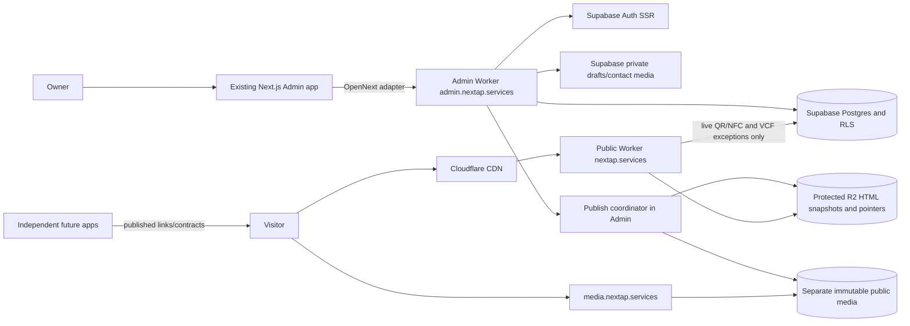

# Migration plan

Target proposal only. No runtime/provider/data changes authorized. See [architecture evidence](../architecture/current-architecture.md), [codebase structure](../architecture/codebase-structure.md), [phase specification](migration-spec.md) and [status](migration-status.md). Audit date 2026-10-30.

## Deployment and authority

### Main and Staging

Owner direction, 2026-10-30: **Main is the source of truth that Staging will match.** Approved Main governs application code and intended database schema. Staging follows a specifically reviewed Main release SHA and its approved forward migration set; Staging drift does not redefine Main. Migration work remains based on approved Main, and candidate work must pass review before integration. Record the exact tested SHA and deployed migration evidence before asserting alignment.

Staging alignment means equivalent approved application behavior and schema contracts, with intentionally separate project identities, secrets, bindings, hostnames, Auth configuration and sanitized test data. It does not mean copying live Production rows or credentials. Production-to-Staging data preparation is a separate, approval-gated operation below. Production stays on Vercel pending explicit cutover approval.

The observed missing Staging `update_business_page` RPC is drift to reconcile against Main's approved schema intent, including authorization and grants. Compare definitions and migration history, then propose reviewed forward migrations; do not treat the live Production catalog or Staging history as a replacement source. No deployment, database change or synchronization occurs in this foundation.

| Component | Responsibility and boundary | Initial status |
| --- | --- | --- |
| Existing Next.js Admin app + OpenNext | Adapt existing compatible App Router build to Worker; publish coordinator remains in Admin. Pin Next/OpenNext/Wrangler/runtime separately. | Required; compatibility unproven |
| Admin Worker at `admin.nextap.services` | Admin UI/actions, Auth, drafts/cards/uploads/private preview and publication workflow. | Required |
| Public Worker at `nextap.services` | Resolve public slug/status/alias and serve prepared HTML; narrow live QR/NFC and VCF exceptions; no ordinary Supabase requests, Admin routes/secrets or R2 writes. | Required |
| DNS, CDN and TLS | Host routing, managed certificates, response security and public delivery. Hostinger remains registrar; nameserver delegation is a later approved action. | Required at cutover |
| Protected R2 artifacts/pointers | Logical HTML, snapshot and slug map. Admin writes; Public receives a provider-enforced read-only binding; no raw or unguarded publication-ID endpoint. | Required |
| Separate public R2 media | Immutable display objects on `media.nextap.services`; no draft/contact bytes; retention and purge policy must be approved. | Needed if public immutable media is accepted |
| Cache API | Optional bounded Worker response/map cache; per-colo and purge is acceleration. A cache hit still executes the Worker. | Conditional |
| Supabase PostgreSQL and RLS | Business identity/source, drafts, publications/history, cards, audit and narrow Admin/public-exception RPCs. | Keep as control plane |
| Supabase Auth | Admin owner sessions and verified claims. | Keep as control plane |
| Supabase Storage | Private drafts, originals, owner preview and contact photos initially. | Keep initially |
| Image-processing capability | Validate/prepare display and contact derivatives without weakening privacy or format/size bounds. | Required capability; execution runtime gated by proof |
| Observability | Sanitized Worker logs, errors, release/environment identity, latency/CPU/requests and repair evidence. | Required before Staging acceptance |
| Queues, KV, Durable Objects, D1, Containers, Cloudflare Images | No demonstrated need for initial target. | Defer pending a specific measured benefit |
| Third publisher Worker | Adds lifecycle, identity and credentials; it does not replace authorization. | Defer absent a demonstrated CPU/duration/reliability/permission/scaling limit |

### Image-processing options

The current media path depends on native Sharp. `nodejs_compat` only exposes selected Node APIs and does not make native addons available. The two app Workers are not a complete processing plan if Sharp remains.

| Candidate | Benefit | Cost or risk to resolve before selection |
| --- | --- | --- |
| Worker-compatible WASM codecs | Keeps validated image preparation in the Admin request path and avoids a separate service. | Verify supported AVIF/WebP/JPEG/PNG codecs, orientation and metadata handling, memory/CPU limits, build size and image-quality parity with the current rules. |
| Cloudflare Images transformations | Managed transformation path with documented Worker integration. | Separate storage/privacy, format, pricing, deletion, origin authorization and contact-photo eligibility decisions; do not route private media through public transformation URLs. |
| Dedicated Node image runtime retaining Sharp | Preserves current codec behavior while app Workers move independently. | Adds another execution runtime, deploy/identity, request authentication, size/time limits, private network path, telemetry and rollback. In that case the architecture has more than two runtimes even if only two application Workers exist. |

The browser crop UI is an editing aid, not a trusted validation boundary. Keep server-side byte inspection, still-image rejection, dimensions/pixels, orientation, metadata and output-size checks whichever processor is selected.

Two deployments do not require two repositories. Independent future features own their own repo, data/migrations/deploy/release and enforce their own tenant entitlement. Portfolio consumes published descriptors/links only. No shared service-role, parent-domain cookie or cross-feature table. `businesses.id` UUID is a candidate integration ID, not authorization or proven immortal identity; resolve deletion/tombstone lifecycle. No feature registry was found; add only a minimum descriptor to existing Core source if needed.

### Domain and DNS

Target public nextap.services, Admin admin.nextap.services, media media.nextap.services. Public lookup on 2026-10-30 showed Hostinger parking nameservers, not a verified Cloudflare zone or deployment. Older handoffs also mention nextapp.services/nextab.services; treat those as conflicting historical labels, not alternate intended domains. Keep Hostinger registrar; no transfer is needed.

Proposed Staging names are `staging.nextap.services`, `admin-staging.nextap.services` and `media-staging.nextap.services`; confirm ownership and availability before binding them. Use host-only Secure/HttpOnly cookies on the Admin host, no parent-domain cookie by default, and exact Staging-only Auth callback/origin allowlists. Preflight exports the current zone, verifies web and MX/SPF/DKIM/DMARC/TXT/CAA records, checks Vercel bindings, Auth callbacks, certificates and DNSSEC state, and compares each imported record before changing nameservers. Only lower TTLs for reviewed web records to the approved pre-cutover value; no record values or current TTLs are available here. Change DNSSEC DS state in the documented Cloudflare order. Rollback keeps the Vercel app and prior record set available and can restore prior Hostinger delegation, subject to resolver/cache propagation. Do not invent IP/CNAME targets or change DNS in this foundation.

## Published artifacts and rendering

Proposed keys (logical, not mandatory): published/{publication_id}/index.html, published/{publication_id}/snapshot.json, slugs/{validated_slug}.json, media/{sha256}.{extension}. Keep pointer/artifact and public-media policy separate. Do not expose raw bucket or unguarded historical publication IDs.

Slug map has version, validated active/alias/unavailable state, canonical slug, opaque publication UUID, monotone generation and artifact key. Snapshot is an allowlisted versioned projection: display name/category/page, enabled sections, resolved provider profiles and approved public image URLs. Exclude raw DB rows, drafts, auth, tokens, private contact/photo, Admin flags and credentials. Validate URL scheme/host/length/control chars; escape HTML text/attributes and embedded JSON. Render canonical/title/description/OG, Arabic lang/RTL, accessible alt/geometry and explicit CSP/cache headers. Existing React Portfolio renderer has client and Next Image dependencies; it is not proven as a standalone HTML generator. Build a deterministic publish-time renderer, not request-time content rendering/transform. Deploy-time Worker static assets and dynamic R2 objects are distinct.

Keep public display eligibility separate from URL possession. If a published media URL must become private immediately, an unguarded custom-domain object cannot satisfy that requirement; use an authorization-gated path for that asset class. Public immutable URLs remain retrievable from saved/browser copies until the approved retention and purge policy takes effect.

## Publish protocol and consistency

Admin coordinator: authorize publish capability; capture consistent source revision; validate slug/schema/media; create idempotent attempt; promote only approved display media after hash/MIME/extension/magic/dimension/orientation/integrity checks; render; write immutable snapshot/HTML; read back and verify checksum/headers; activate pointer last; reconcile alias/status; purge relevant cache as acceleration; record result and keep last-good. Postgres atomicity ends at DB; it cannot transact with R2.

Concurrency proposal: allocate increasing per-page generation plus unique publication ID in source-of-truth metadata. Activate pointer via R2 conditional ETag compare-and-swap (onlyIf); first write uses create-if-absent. If condition fails, reread generation; stop when live generation is equal/newer. An old publisher must never blindly retry over a newer generation. Rollback is a new higher generation pointing to retained older content. Confirm R2 condition/ETag behavior in Staging. A revision check before external write alone is not concurrency control. New slug and old alias are separate objects; destination first, then alias, and document/test the bounded inconsistency window.

| Failure window | Result and recovery |
| --- | --- |
| Before artifact writes | Old page remains; retry same attempt |
| Partial media | No activation; resume by digest or age out after grace |
| HTML/hash incomplete | Keep last-good pointer |
| CAS loses | Reread and stop stale publisher |
| Crash after pointer before DB bookkeeping | Verify pointer/artifact and reconcile idempotently |
| Rename partly written | Destination active first; repair old alias |
| Purge failure | Retry; natural hard TTL still bounds freshness |
| R2/DB outage | Do not activate; keep last-good; QR/VCF fail closed |
| Deactivate/unpublish | Higher-generation unavailable status then purge |
| Rollback/GC | Higher generation; retain old/shared media until refcount and retention check |

Track publish attempts, artifacts and digests for retry/orphan repair. Do not delete source media during migration.

## Caching and revocation

Proposed maximum canonical visibility delay: 60 seconds; requires business approval. Purge accelerates but does not prove global invalidation. Avoid stacking full TTLs: browser HTML max-age=0,must-revalidate; canonical map/edge status hard <=60 seconds and no stale-if-error extension; immutable versioned assets long-cache; brief negative cache only after testing. Normalize host/path/query; ignore unknown tracking variants; do not vary content on cookies or emit cookies. Purge slug/alias after publish. Cache API is per colo; hit still invokes Worker. Measure direct R2 CDN separately.

| Event | Source update and purge | Layers and realistic maximum | Failure behavior | Test and approval |
| --- | --- | --- | --- | --- |
| Deactivate or unpublish | Higher generation marks slug unavailable; purge canonical map and page response | Browser revalidates; map/Worker <= approved 60 seconds; no stale extension | After bound, return unavailable even during origin outage; purge failure waits for hard TTL | Multi-region cold/warm and purge-failure tests; owner approves freshness bound |
| Rename | Publish new canonical pointer, then old-slug alias; purge both keys | Two-key inconsistency tested; each map entry within same 60-second budget | Retry alias repair; old canonical may remain visible only within budget | Concurrent rename and interruption test; approve alias-retention policy |
| Feature removal | Remove descriptor/link in Core snapshot and purge page; app checks its own entitlement | Portfolio link follows page bound; feature authorization is independent | A direct feature URL remains governed by that feature app's access checks | Test link removal and direct unauthorized access; feature owner approves contract |
| Compromised QR/NFC | Disable/reassign card in DB; no cache on `/c` | Next token resolution sees live DB state; already-open profile is unaffected | On DB outage, fail closed; do not log token or extend prior resolution | Test rotate/disable, no-store headers, token-redacted logs and outage; owner approves recovery |
| Public media removal | Unpublish reference, purge media CDN key and delete only after retention/reference check | Edge/browser copies can remain through configured TTL; downloaded copies cannot be recalled | Shared content hash remains while referenced; strict immediate revocation needs private gate | Test eligible/ineligible/shared-hash cases and purge failure; owner approves public-media retention |
| Rollback | New higher-generation pointer selects retained last-good artifact; purge alias/canonical | Same hard visibility bound; never move generation backwards | Preserve bytes and reconcile DB/R2 pointer state before retry | Crash/concurrency/replay test; release approver approves exact rollback target |
| R2/Supabase outage | No mutation to a live pointer until artifacts verify; dynamic QR/VCF require live eligibility | Serve verified canonical artifact only within existing bound | No stale extension; QR/VCF fail closed; previous prepared publication remains available | Inject each origin outage and recovery; operator runbook approval |

Use one end-to-end canonical visibility budget; do not stack two full TTLs. Browser HTML uses max-age=0/must-revalidate. Canonical slug/status map and Worker cache are bounded together to <=60 seconds with no stale-if-error extension. Immutable media may use a long browser/edge TTL only after retention is approved. Public responses emit no Set-Cookie and do not vary by cookie. Normalize host/path, reject malformed or encoded traversal slugs, ignore unrecognized tracking parameters, and purge canonical plus alias keys. Cache API deletion is per colo; CDN purge is acceleration rather than proof that every copy vanished. Create a least-privilege purge credential, check provider endpoint/plan limits and log only object keys/generations, never tokens or customer payloads.

Never cache Admin/auth, private media, /c resolution or VCF. A CDN purge failure must still respect the hard TTL and fail closed at expiry; do not extend stale HTML when R2 or Supabase is unavailable. Direct public media URLs and downloaded/browser copies cannot be recalled; strict URL-level eligibility requires private gating.

## Security and environment separation

Retain RLS, grants, capability RPC, Auth admission, CSRF and fail-closed guards. Admin has host-only Secure/HttpOnly cookie and separate CSRF/origin/callback policy; no parent cookie default. Public has no Admin handler/credential. A TypeScript get-only interface is not permission: enforce R2 Object Read on Public binding, narrow write on Admin, then deploy-test that Public cannot write/list. Separate Worker routes, R2 buckets, Supabase/Auth, secrets, logs and CI identities by Staging/Production. Unknown identity fails closed. Adapt src/lib/config/environment.mjs; do not bypass missing Vercel env. Verify URL/SSRF and HTML validation, body bounds, CSP/CORS, cache poisoning, rate-limit limits and sanitized logs. Production remains Vercel pending explicit cutover approval.

Before execution, verify grants/RLS for every public RPC and publish authorization against approved Main's intended schema. Prevent cross-site Admin mutations with origin/CSRF checks and exact callbacks. Keep QR token values out of URLs in logs, analytics and Sentry; the current process-local limiter is not a global abuse control. Public media and protected artifacts use separate buckets/bindings and keys; Public has no write/delete/list capability at provider level, Admin writes only approved prefixes. Validate redirects/URLs against SSRF and unsafe schemes, bound request bodies before parsing, prevent HTML injection and cache-key poisoning, and preserve CSP/CORS. Redact identifiers and user content from Worker/Sentry logs. A separate Worker is never an authorization substitute.

## Production-to-Staging data copy (plan only)

Staging is editable sanitized test data, not DR. Direction is Production -> Staging. No copy or overwrite occurred.

1. Verify source/destination refs/regions/plans without printing credentials; inventory Staging-only rows/objects and current Staging-only backup/restore; explicitly approve scope and overwrite.
2. Take consistent snapshot and verified Staging recovery. Compare both environments against approved Main migrations and intended schema/extensions, definitions/grants/RLS/policies/triggers/indexes. Resolve Staging drift through separately approved forward migrations before data copy; a Production snapshot must not replace Main's reviewed schema authority.
3. Select business/page/publication/alias/card scope; preserve UUID/FK/sequence/revisions; never reuse live QR/NFC tokens. Isolate Staging card assignments.
4. Prefer separately provisioned test users. Never copy passwords, Auth sessions/tokens, MFA secrets, recovery codes or Production login links. Sanitize contacts, user text and audit data; disable outbound email/SMS/payment/webhooks; keep QR/NFC tokens isolated and unusable against Production.
5. Inventory Storage metadata and actual bytes separately; copy only approved synthetic assets, rewrite origins/paths, exclude private/contact photos unless synthetic, preserve source.
6. Verify counts, FK/orphans, publication pointers/aliases, object checksums/MIME/lengths, grants/RPC and negative anon/non-owner tests. Never print records.
7. On failure stop external effects, isolate destination and restore verified Staging-only database and object backup before reviewed retry. Dump/export success without a tested restore is not recovery evidence.
8. Record identities, timestamp, scope, sanitization, checksums/counts, exact checks and approval. Data copy and code promotion differ.

Supabase Free is owner-stated; current plan/usage and restore availability are unverified. Official Supabase backup docs say Free needs off-site logical export and DB backup excludes Storage bytes. Proposal: encrypted database dump plus separately checksummed/versioned object backup, access/retention controls and tested restore. RPO/RTO and budget are owner decisions; dump without restore drill is not recovery proof.

## Independent features

No independent feature registry or feature application was found in the baseline. Treat `businesses.id` UUID as a candidate stable identity only after verifying delete/tombstone lifecycle; it is never an authorization credential.

Each substantial future feature owns its repository, frontend/backend, data and migrations, Cloudflare deployment and release. It enforces its own tenant authentication and entitlement. Do not share service-role credentials, parent-domain cookies or cross-feature tables. Portfolio reads only a small versioned public descriptor, never a feature database/runtime. Start from existing Core activation data where sound; otherwise add the minimum descriptor contract to Core rather than an empty registry service.

| Menu example step | Ownership and contract |
| --- | --- |
| Create Menu app and data model | Feature repository owns UI/API/schema, auth/tenant checks and its independent deployment. |
| Deploy and register | Feature publishes a versioned descriptor: app ID, contract version, enabled state and validated URL template/config; Core validates and stores activation against business UUID. |
| Preview and publish | Admin preview shows the descriptor; publication writes only approved feature metadata/link into the sanitized snapshot. |
| Navigate and enforce | Portfolio renders the link; Menu rechecks tenant entitlement and authorization on every protected operation. |
| Deactivate | Core removes/deactivates the public descriptor and republishes. The feature app independently denies access; hiding its link is not revocation. |

First integration requires a Core change to validate/version the descriptor and include it in the publication allowlist. Later feature UI/backend releases can be independent; changes to activation semantics or snapshot contracts still require a reviewed Core release.

## Costs and performance

Let B businesses, V=1,000 assumed monthly page views/business, M measured media GETs/view, H measured cache hit fraction, P publishes, Q QR/NFC calls, F VCF calls, A Admin/Auth/RPC calls, C mean Worker CPU ms. Total page views = B times V. Worker requests = HTML views + Q + F + media views only if Worker-routed; prefer direct CDN media. R2 Class B ~= uncached media reads plus artifact reads; Class A ~= immutable writes/pointer operations/retries. Object count, bytes, H, retries and retention are unknown inputs, not invented constants.

| Businesses ` 1,000 views | HTML views/Worker before Q/F | Target Portfolio Supabase RPCs | Current cold request |
| --- | ---: | ---: | --- |
| 100 | 100,000 | 0 | pointer + snapshot; fallback may add RPC |
| 1,000 | 1,000,000 | 0 | same |
| 10,000 | 10,000,000 | 0 | same |

For sensitivity add B*V*M Worker requests when media is Worker-routed; with direct CDN use measured H for R2 misses. Rates checked 2026-10-30: Workers Paid minimum $5/month includes 10M requests and 30M CPU-ms, then $0.30/M requests and $0.02/M CPU-ms. Cache API hits still count as requests. R2 Standard is $0.015/GB-month, $4.50/M Class A and $0.36/M Class B; monthly allowance 10GB-month, 1M A and 10M B; egress is free. These are list-price formulas, not an account quote or savings claim. Supabase retains Admin/Auth/publish/Q/F usage; zero ordinary Portfolio RPC is not zero total usage. Vercel plan/use is unknown. Recheck rates before approval.

Count these separately in a future measured model; none of the unknowns below should be filled with assumed asset counts or cache hit rates:

| Cost surface | Required workload terms |
| --- | --- |
| Worker | HTML requests + QR/NFC Q + VCF F + any Worker-routed media; each Cache API hit remains a Worker execution. Track p50/p95 CPU C, subrequests, memory/errors and request/CPU allowance. |
| R2 Class A | Publish/media writes + pointer conditionals + metadata/list/retry/repair operations; track retries and failed attempts. |
| R2 Class B | Slug/pointer/artifact reads + media GET/HEAD that reach R2; estimate with measured CDN miss rate H, not a presumed cache hit. |
| R2 storage/retention | Current and retained HTML/snapshot versions + unique media bytes + orphan grace + independent backup bytes; shared content hashes count once while referenced. |
| Admin and publishing | Owner sessions/Auth, draft/publish RPCs, media promotion, readback, purge and repair attempts; include peak publication bursts. |
| Supabase | DB size, API/RPC, Auth MAU/email/SMS, uncached/cached egress, private Storage bytes and backup exports. Visitor DB reads reaching zero does not remove these uses. |
| Logs and recovery | Sanitized event volume/retention, DB dump storage/egress, separately copied object bytes and restore-drill transfer/compute; account pricing and retention are unknown. |

Official Supabase Free list limits checked 2026-10-30: $0; 500 MB database; 5 GB egress plus 5 GB cached egress; 1 GB file storage; 50,000 MAU; two active projects; unlimited API requests; inactivity pause after a week of low database activity. The pause threshold is not quantified; a paused Free project is documented as restorable for up to 90 days. Free does not receive automatic daily DB backups: export and keep an off-site logical backup, and back up Storage object bytes separately because database metadata backup is not object-byte backup. These are published limits, not inspected account usage or restore readiness. [Supabase pricing](https://supabase.com/pricing), [Free pause policy](https://supabase.com/docs/guides/platform/free-project-pausing), [backup guide](https://supabase.com/docs/guides/platform/backups), [Storage object downloads](https://supabase.com/docs/guides/storage/management/download-objects).

The three business scenarios are formula-only: 100,000, 1,000,000 and 10,000,000 monthly HTML views before Q/F/media; multiply each by measured M/H and include media only when Worker-routed. Add P publication writes and retries, Q card redirects, F contact downloads, A Admin calls, log bytes L, DB dump bytes D and object-backup bytes O as separately measured inputs. R2 custom-domain CDN hits may avoid origin Class B operations, but Worker routes and Cache API hits still execute unless routing/billing evidence proves otherwise. R2's free tier is separate from Workers' static-asset allowance.

Targets proposed, not achieved: zero Supabase request on ordinary Portfolio HTML/metadata/middleware/browser/media cold, warm, miss and error paths; no request-time content render or image transform. With adequate field sample p75 LCP <=2.5s, INP <=200ms, CLS <=0.1. Weak-mobile lab median LCP <=4s at 1.6 Mbps/150ms RTT/4x CPU; comparable warm p95 TTFB <=300ms, cold <=700ms; compressed first view HTML <=35 KiB, critical CSS <=20 KiB, JS <=75 KiB, fonts <=50 KiB, total <=300 KiB and <=12 critical requests. Preserve content and Arabic glyph coverage.

Measure exact SHA/date/region/device/viewport/CPU/network and cold/warm CDN/browser; at least five runs per lab condition, report median/tails, not sparse field p75. Measure TTFB/CWV/bytes/requests/image discovery/errors/Worker CPU+calls/R2 A+B/Supabase requests. Prove no database traffic with runtime instrumentation and browser trace. Existing single trace is not baseline.
