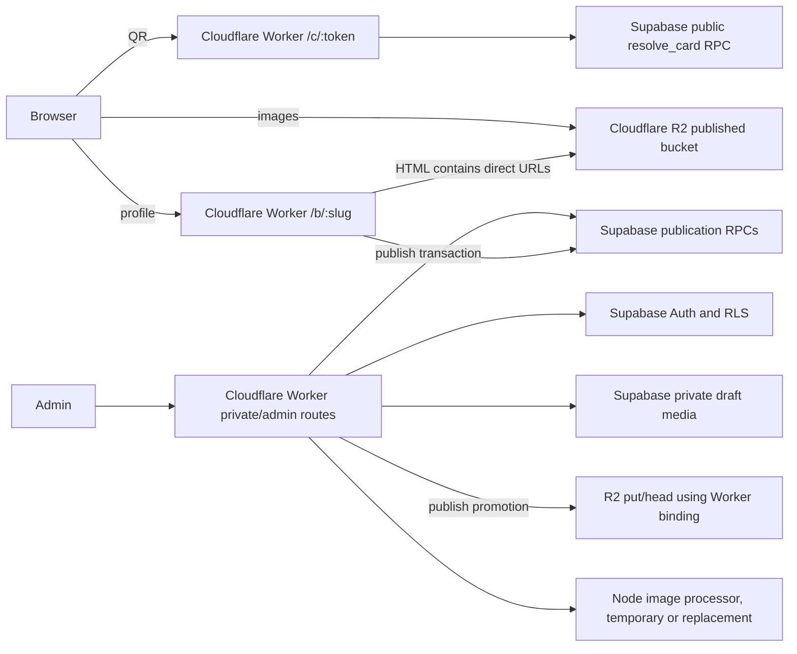

# NexTap Cloudflare Workers and R2 Migration Specification

Status: proposed implementation plan. No provider, DNS, database, or storage mutation is authorized by this document.

Date: 2026-10-28

This specification describes a staged migration from Vercel to Cloudflare Workers Paid, with published profile media delivered from Cloudflare R2 and Supabase retained for PostgreSQL, Auth, RLS, publication metadata, and private media workflows.

## 1. Objective

Move the public NexTap workload to a stack whose included request envelope is materially larger than Vercel Hobby, while preserving the current publication and authorization behavior:

- Cloudflare Workers Paid runs the Next.js application through a tested OpenNext adapter.
- Cloudflare R2 serves immutable, published display media directly from a custom media domain.
- Supabase remains the system of record for PostgreSQL, Auth, RLS, publication snapshots, cards, audit data, and draft/private media.
- The existing QR flow remains a two-request flow during the baseline migration: `/c/:token` then `/b/:slug`.
- Published media moves off the dynamic `/api/media` Worker path. Drafts and contact-photo downloads retain an authorization-aware Supabase path.

The migration is complete only when the compatibility, privacy, media-integrity, rollback, and measured-capacity gates in this document pass in a non-production environment first.

## 2. Scope

### In scope

- OpenNext/Cloudflare Worker build and runtime compatibility.
- Cloudflare DNS and Worker deployment configuration, after explicit release approval.
- A separate public R2 bucket for published display assets.
- A private Supabase or private R2 path for draft and owner-only assets.
- A delivery manifest and dual-read fallback for managed media.
- Published-media backfill with checksum and MIME/dimension verification.
- Publish-time promotion of new managed assets before a publication becomes visible.
- Route headers, CSP, image allowlists, observability, alerts, tests, load tests, and rollback.
- Capacity accounting for 150, 750, 1,041, and 1,350 businesses under the stated traffic assumptions.

### Out of scope

- A redesign of the public profile renderer.
- A change to card-token semantics, slug aliases, or publication authorization rules.
- Visitor analytics writes to PostgreSQL.
- A blanket conversion of all external image URLs.
- Deleting Supabase source objects during the migration window.
- Treating ISR as a capacity guarantee before it is measured on the deployed cache adapter.
- Making the one-request QR flow mandatory for the baseline cutover. It is described as a feature-flagged migration option, with the existing redirect mode retained for rollback.

## 3. Current architecture and evidence

The following facts come from the checked-in source and the architecture/media handoffs. They are constraints for the implementation.

| Area | Current behavior | Migration implication |
| --- | --- | --- |
| Card scan | `GET /c/:token` validates syntax, calls `resolve_card`, and returns an uncached zero-body `302` to `/b/:slug`. | Keep it dynamic and `no-store`; card reassignment and deactivation must become visible immediately. |
| Public page | `GET /b/:slug` is `force-dynamic`; publication lookup uses React memoization, a five-second process cache, immutable snapshot caching when Phase 6 RPCs exist, and a five-second fallback. | Keep live slug/activation checks. Do not enable generic HTML CDN caching as part of the first cutover. |
| Public media | Managed paths currently go through `src/app/api/media/[...path]/route.ts`, which reads Supabase Storage and returns `public, max-age=60, must-revalidate` for published bytes and `private, no-store` for owner reads. | Direct R2 URLs should be used only after a path is verified as published and mirrored. Keep the route as a fallback and for private workflows. |
| Storage policy | `business-media` is private; publication access is controlled by `private.publication_media` and Storage RLS. | Do not make the existing Supabase bucket public. R2 must use a separate published bucket so draft paths cannot be exposed by a public custom domain. |
| Publication data | Anonymous access is through narrow RPCs such as `resolve_card`, `get_published_page`, `get_publication_pointer`, and `get_publication_snapshot`. | Keep table access and RLS unchanged. Any new public RPC output must be limited to the current active publication. |
| Upload processing | Admin upload and contact-photo generation use Node `Buffer`, `node:crypto`, and native `sharp`. | `nodejs_compat` is not proof that native Sharp works in Workers. The upload path needs a separate compatibility proof or a Node image service. |
| AVIF | AVIF is accepted by `media_assets`, but the current publication-media path allowlist was observed to omit AVIF. The production investigation recorded a published AVIF returning `404`. | Correct the allowlist and explicitly re-register eligible existing AVIF references before using their delivery as a performance baseline. |
| Draft preview | Drafts render through owner routes and may use `/api/media` with a session. | Draft previews must never receive a public R2 URL. |
| Contact downloads | Public contact RPCs return a contact projection and read the contact JPEG through the Supabase-aware path. | Keep contact-photo bytes on the authorization-aware path in the baseline. Do not put contact derivatives in the public R2 bucket without a separate privacy decision. |

References:

- [`docs/ARCHITECTURE.md`](../ARCHITECTURE.md)
- [`docs/handovers/ARCHITECTURE_CAPACITY_HANDOFF.md`](../handovers/ARCHITECTURE_CAPACITY_HANDOFF.md)
- [`docs/handovers/LAUNCH_ARCHITECTURE_HANDOFF.md`](../handovers/LAUNCH_ARCHITECTURE_HANDOFF.md)
- [`docs/research/PUBLIC_PROFILE_MEDIA_AND_PERFORMANCE.md`](../research/PUBLIC_PROFILE_MEDIA_AND_PERFORMANCE.md)
- [`src/lib/media/urls.ts`](../../src/lib/media/urls.ts)
- [`src/lib/media/read-object.ts`](../../src/lib/media/read-object.ts)
- [`src/lib/business/public-publication.ts`](../../src/lib/business/public-publication.ts)

## 4. Target architecture



### Component ownership

| Component | Responsibility | Required boundary |
| --- | --- | --- |
| Cloudflare Worker/OpenNext | Public routes, admin routes that are runtime-compatible, headers, rate limits, publication reads, and fallback media route. | No service-role key in browser code or response bodies. |
| R2 `nextap-published-media` | Public display media that is present in an active published snapshot and has passed integrity checks. | Public custom domain; no draft or owner-only objects. |
| R2 private bucket, if used | Optional future private copy for owner-only media. | No public custom domain; access through an authenticated Worker route. |
| Supabase PostgreSQL | Businesses, pages, sections, publication snapshots, cards, aliases, audit records, media metadata, and publication authorization. | Keep narrow invoker wrappers and existing RLS. |
| Supabase Auth | Owner sessions, claims, and session refresh. | Keep publishable key in browser only; secret/service keys stay server-side. |
| Supabase Storage `business-media` | Source of truth during migration, draft/private media, and contact-photo bytes in the baseline. | Keep bucket private and Storage RLS enabled. |
| Node image processor | Sharp-based upload normalization until a Worker-compatible replacement is proven. | Isolate from public profile traffic. |

### Asset classification

| Asset | Public R2 in baseline? | Source and fallback |
| --- | --- | --- |
| Published hero cover | Yes, when mirrored and registered for the active publication. | Supabase Storage through `/api/media` if no ready R2 mapping. |
| Published logo | Yes, same rule. | Supabase fallback. |
| Published gallery/map/payment/background image | Yes, same rule. | Supabase fallback. |
| Draft preview image | No. | Authenticated `/api/media` and private Supabase Storage. |
| Contact-photo derivative used inside vCard | No in baseline. | Supabase-aware `readContactPhoto` path. |
| External owner-supplied URL | No migration. | Existing URL validation and browser behavior. |

Published display media is public product content. A public R2 URL cannot provide immediate revocation after a URL has been disclosed. Deactivation must remove the asset from new HTML and mark the object for deletion/purge after the rollback retention window. If the product requires strict URL-level revocation, use a Worker-gated private bucket for that asset class and recalculate the request capacity; do not silently claim that a public R2 URL preserves strict revocation.

## 5. Behavioral and security contracts

### Public routing

1. `/c/:token` remains `force-dynamic`, validates the existing 32-64 character token pattern, applies rate limiting, calls only `resolve_card`, and returns `Cache-Control: no-store, max-age=0`.
2. `/b/:slug` keeps the live pointer/activation check. A cached immutable snapshot is usable only after the RPC verifies that it is the current active publication for the requested slug or alias.
3. Admin, login, draft preview, contact download, and mutation endpoints remain private and `no-store`.
4. `/api/media/:path` remains available during migration. It must continue to reject malformed paths, require a valid owner session for private reads, and never cache a draft response.
5. Direct R2 URLs are emitted only for managed display paths in the current active publication whose delivery state is `ready` and whose checksum has been verified.

### R2 response contract

- Custom domain: `https://media.<production-domain>` or a separately approved media domain.
- Object keys are immutable and contain no user-controlled path segments.
- Response headers: `Content-Type` from the verified MIME, `Cache-Control: public, max-age=31536000, immutable`, `ETag`, and `X-Content-Type-Options: nosniff`.
- Do not send `Vary: Cookie` for public R2 responses.
- Do not put session tokens, card tokens, owner IDs, or arbitrary query strings in R2 URLs.
- R2 origin must not be used for draft previews or contact-photo bytes in the baseline.
- Update the application CSP `img-src` and Next image `remotePatterns` to allow only the approved media origin.

### Supabase security contract

- Keep `public` table access and `private` schema boundaries unchanged.
- New delivery metadata belongs in the private schema or is exposed only through a narrow public RPC projection; never expose the delivery table through the Data API.
- Use `TO anon`/`TO authenticated` grants and ownership predicates as appropriate. Do not add broad anonymous table grants.
- Do not use `raw_user_meta_data` for authorization decisions.
- Never expose `service_role`, R2 secret access keys, or migration credentials through `NEXT_PUBLIC_*` variables.
- Keep publication-media authorization for the Supabase fallback. The R2 promotion job may read a source object only after the source path is verified as owned by the business and referenced by a publishable snapshot.

### Failure behavior

- If R2 is unavailable during a public read and the response contains a ready R2 URL, the browser may fail that image. The HTML path must remain healthy; the next publish/backfill verification must detect the failure. Do not add a per-image Worker proxy solely to hide an R2 outage.
- If promotion fails before publication, leave the draft saved but do not activate a new publication in direct mode. Show an actionable retry error to the owner.
- If a ready mapping fails checksum verification, mark it `failed`, stop direct use for that path, and fall back to `/api/media` after the next public snapshot read.
- If Supabase publication RPCs fail, preserve the current route error/fallback behavior and alert. Do not serve draft data.

## 6. Media delivery design

### Canonical identity and object key

The existing Supabase storage path remains the canonical source identity. It is not renamed in the database or deleted during this migration.

Use an opaque, content-addressed R2 key:

```text
v1/<sha256>.<extension>
```

Examples:

```text
v1/3f2c...a90b.avif
v1/8bd1...4f02.webp
```

The extension is selected from verified bytes, not from an unchecked filename. The same source bytes may be deduplicated. The URL is immutable; a new upload receives a new source UUID and a new hash/key.

### Delivery metadata

Add a forward-only private-schema table through a reviewed Supabase migration. The exact names may follow local conventions, but the contract is:

```text
private.media_delivery
  storage_path text primary key
  r2_key text unique not null
  sha256 text not null
  mime_type text not null
  size_bytes bigint not null
  state text check (state in ('pending','ready','failed','revoked'))
  first_verified_at timestamptz
  last_verified_at timestamptz
  last_error text
  created_at timestamptz
  updated_at timestamptz
```

Rules:

- Keep this table private and deny direct Data API access.
- `ready` means the R2 object was written, read back, and matched SHA-256, MIME, and byte length.
- `failed` never authorizes a direct R2 URL.
- `revoked` is retained for audit and rollback reasoning; it is not a public mapping.
- Do not include contact-photo paths in the public delivery projection in the baseline.

The public publication RPCs should add a bounded `mediaDelivery` object to their returned snapshot projection. It maps only managed source paths in the current active publication to their ready R2 URL. The stored immutable snapshot remains unchanged. Both `get_publication_snapshot` and the compatibility `get_published_page` path must return the same projection shape so behavior does not differ by environment.

Keep `public.media_assets.storage_path`, `contact_photo_path`, `mime_type`, and `size_bytes` as the source and ownership metadata. Do not replace those fields with a public R2 URL. The private delivery table records the derived copy and its verification state; this keeps owner metadata and public delivery state in separate authorization domains and allows the R2 copy to be removed or rebuilt without changing a publication's canonical source path.

The renderer must resolve an image in this order:

1. If the publication projection contains a verified R2 mapping for the exact managed source path, use the R2 URL.
2. Otherwise, preserve the current `/api/media/<path>` fallback for managed Supabase URLs.
3. Preserve external URLs only when they pass the existing URL validation rules.

Admin preview snapshots have no `mediaDelivery` projection and therefore continue to use the private fallback path.

### Backfill manifest

Create a resumable, idempotent migration script under `scripts/media/` that:

1. Reads the active publication media set from the private publication tables, excluding contact derivatives.
2. Resolves each source object through the private Supabase Storage path.
3. Validates the bounded body, MIME, dimensions, animation/still-image rules, and maximum byte/pixel limits already enforced by the application.
4. Computes SHA-256 and writes the object to R2 with the exact content type and immutable cache policy.
5. Reads the R2 object back with `HEAD` or a bounded `GET` and verifies size, type, and digest.
6. Upserts `private.media_delivery` with `ready` only after verification.
7. Records a durable manifest row/log containing source path, R2 key, digest, byte count, and timestamp.
8. Retries transient errors with bounded backoff and leaves permanent failures as `failed` for operator review.

The script must be safe to rerun. It must never delete a source object, replace an immutable R2 key, or mark a row `ready` without verification.

### New publish flow

The current `save_contact_draft(..., publish=true)` RPC publishes inside the same database transaction and cannot perform an R2 write. The application publish coordinator must become:

1. Authenticate and authorize the owner exactly as today.
2. Save and validate the draft with `publish=false`.
3. Extract only managed display paths referenced by the validated draft and current contact/publication rules.
4. Copy missing paths to R2, verify them, and upsert `private.media_delivery` as `ready`.
5. Call the existing publication transaction (`publish_page` or the forward-compatible publication wrapper).
6. Revalidate the public route and admin route.

Direct-mode publication must not activate when required promotion has failed. The existing authenticated RPC may remain as a compatibility fallback during rollout, but application code must route all normal publish buttons through the coordinator and alert when an active publication has a missing delivery mapping.

### AVIF correction gate

Before any backfill:

- Update the publication-media path extraction allowlist to include `.avif` wherever WebP/PNG/JPEG are accepted.
- Re-register or republish existing active snapshots whose AVIF references were skipped by the old trigger.
- Verify one active AVIF, one active WebP, one missing asset, and one deactivated publication through both Supabase fallback and R2 projection paths.

Do not judge R2 performance from a media object that is still failing the current publication-media registration contract.

## 7. Cloudflare runtime compatibility plan

### Proof of concept

Create a separate preview deployment before changing production DNS. Pin the OpenNext and Wrangler versions in the lockfile and add the minimum Worker configuration:

- `compatibility_date` pinned to the tested date.
- `nodejs_compat` enabled only where the POC demonstrates it is needed.
- R2 binding available only to server-side code.
- Explicit environment names for local, staging, preview, and production.
- No production Supabase or R2 secrets in the preview environment.

The POC must build and execute the following route matrix:

| Route/workflow | Required proof |
| --- | --- |
| `/c/:token` | Valid, invalid, unassigned, inactive, and reassigned card behavior; no-store headers. |
| `/b/:slug` | Active slug, old alias, missing slug, archived/inactive page, publication cache path, and Supabase outage fallback behavior. |
| Public images | R2 URL projection, Supabase fallback, AVIF/WebP headers, and CSP. |
| Login/session refresh | Auth cookies, claims, owner allowlist, logout, and private cache headers. |
| Draft/editor | Save, preview, publish, revision conflict, and draft media authorization. |
| Media upload | Upload, MIME/dimension validation, contact-photo generation, metadata insert, and cleanup. |
| Contact download | Slug and card-token downloads, private/no-store response, and photo inclusion. |
| Manufacturing/export | ZIP generation and authenticated private response. |
| Error telemetry | Sentry release/environment tagging without cookies, tokens, or personal data. |

### Sharp and Node-only work

Native `sharp` is the hard runtime gate. Choose and document one of these implementations before cutover:

1. Keep upload/contact-photo processing on a small isolated Node service and route only those authenticated admin calls to it.
2. Replace Sharp with a Worker-compatible, security-reviewed image pipeline and prove parity for orientation, animation rejection, pixel limits, AVIF/WebP output, and contact-photo cropping.
3. Keep the admin upload origin on the existing Node deployment while public and compatible routes move to Cloudflare.

Do not claim a full Vercel-to-Workers migration while the upload route still depends on an unproven native module. Public profile traffic must not depend on the image processor being available after media has been promoted.

### ISR decision

Do not enable ISR in the baseline migration. The current page combines live activation/alias checks with immutable publication snapshots. An ISR layer can cache a deactivated page or old slug unless invalidation and eligibility checks are proven across Worker isolates and regions.

After cutover, a separate experiment may cache only an eligibility-safe public response using the OpenNext incremental cache adapter. It must prove publish invalidation, slug alias behavior, deactivation, cache persistence, and rollback. Capacity calculations in this document do not count ISR savings.

## 8. Safe optimization plan

The following optimizations are part of the migration plan or an explicitly bounded follow-up. Each has a different effect; reducing image bytes improves egress and load time but does not reduce the two Worker requests created by a QR visit.

| Optimization | Status | Capacity or UX effect | Safety gate |
| --- | --- | --- | --- |
| Direct R2 delivery for published display media | Included in baseline | Removes published image bytes from Supabase Storage and the dynamic media Worker route. R2 Class B reads still apply. | Only ready, checksum-verified paths in the active publication receive an R2 URL. |
| Immutable publication pointer/snapshot RPCs | Included in baseline | Reduces repeated publication reads when Phase 6 RPCs and a persistent cache are actually deployed. | Live slug, alias, active, and business-status checks remain in the pointer/snapshot contract. |
| Preserve already-small valid AVIF inputs | Included before direct mode | Prevents the current Sharp pipeline from expanding an already optimized AVIF; lowers image bytes and LCP. | Validate still-image bytes, orientation, dimensions, pixel limit, and metadata policy first; re-encode when normalization is required. |
| Stable immutable image headers | Included in baseline | Improves browser/CDN reuse and avoids repeated media reads. | New object keys for every changed byte; no cache-busting query strings. |
| Below-the-fold image loading | Included as a bounded renderer change | Reduces initial R2 Class B reads and improves first viewport rendering. Hero remains eager/high priority; gallery and lower sections stay lazy. | Verify no layout shift, no broken keyboard access, and no missing images after scroll. |
| Keep analytics out of synchronous Postgres | Included in baseline | Avoids one or more database writes per QR visit. | Use privacy-minimized browser analytics later if needed; never send card tokens or personal data. |
| One-request QR flow | Migration option, feature-flagged | Removes the `/c` plus `/b` double-request and raises the theoretical Worker envelope from about 1,041 to about 2,083 businesses. Supabase still receives the card-resolution and publication reads inside one Worker invocation. | Requires a same-request page route, card-resolution and page-render error design, and a separate load/E2E release. |
| ISR or shared HTML caching | Deferred follow-up | Could reduce `/b` requests and Supabase reads, but may serve stale or deactivated pages if invalidation is incomplete. | Prove activation, alias, publish, deactivation, cache persistence, and rollback across Worker isolates before counting any savings. |
| Font and client-JavaScript reduction | Measured UX experiment | May improve LCP and transfer size; it does not materially change Worker request quota. | Use route-specific traces; preserve Arabic glyph coverage and all public interactions. |

### Pre-migration implementation order

1. Deploy and verify the Phase 6 publication pointer/snapshot RPCs, while retaining the five-second compatibility fallback.
2. Measure current image dimensions and bytes by role. Add conditional AVIF pass-through so a valid AVIF below the role limits is not re-encoded solely because it is AVIF.
3. Keep the hero eager and defer gallery, map, payment-background, and other below-the-fold media where the current layout permits it. Verify CLS and scroll-to-image behavior.
4. Complete the R2 backfill and direct URL projection. This is the main capacity optimization because media no longer consumes Supabase Storage delivery or a Worker response body.
5. Run the 150/750/1,350 synthetic profiles with one, two, and three images per visit. Use measured R2 Class B reads and cache-hit rate to choose the launch image budget.
6. Treat the one-request QR flow as a feature-flagged migration workstream and ISR as a separate follow-up. Do not include one-request savings in the baseline capacity number until its gates pass.

The 25 KB media value in the capacity table is a target to measure against, not an assumption that the current Sharp output already meets. The production media investigation showed that a 12.7 KB source AVIF can become roughly 43-46 KB after a quality-60 re-encode, so the pass-through decision must be tested with orientation and security validation rather than inferred from the filename.

### One-request QR implementation path

This is feasible within the migration, but it changes the response contract and must be enabled only after the two-request baseline is stable.

1. Replace the current `/c/[token]/route.ts` GET implementation with an App Router page implementation that can render `PublicSnapshot` after resolving the card. Keep the existing `/c/[token]/contact.vcf` child route unchanged.
2. Share one cached resolver for `generateMetadata` and the page body so the token is validated and `resolve_card` is called once per incoming request.
3. For an active card, call `getPublicPublication` with the validated slug and render the profile in the same request. Do not trust a slug supplied by the client.
4. For invalid, unassigned, inactive, or unavailable cards, render the existing unavailable state directly instead of redirecting to another route. Preserve the current rate limit, `no-store`, `no-referrer`, and error telemetry behavior.
5. Set the canonical metadata URL to `/b/<slug>` so token URLs do not become duplicate indexed pages. Preserve `via=qr|nfc` as a validated, non-sensitive source value if the page uses it.
6. Keep a feature flag with two modes: `redirect` preserves the current `302` behavior, and `render` enables the one-request page. The flag must be environment-scoped and reversible without a database migration.
7. Update QR generation only after the rendered mode passes. Existing QR codes can keep the `/c/<token>` path; the same path changes from redirect mode to render mode when the flag is enabled.

The one-request mode still performs two logical Supabase reads in a cold request (`resolve_card` and publication lookup). Its primary benefit is the Worker request envelope and one less browser round trip; it is not a Supabase-query reduction. Test cold and warm publication caches separately, because rendering the page in the card route may increase Worker CPU and HTML work per invocation.

Required gates before enabling `render` in production:

- The current redirect E2E journeys pass in `redirect` mode and the same journeys pass with direct profile rendering in `render` mode.
- Invalid, unassigned, inactive, reassigned, and deactivated cards never render a stale or draft profile.
- `/c/<token>` remains `Cache-Control: no-store, max-age=0`, and the profile HTML contains the expected direct R2 URLs or safe Supabase fallbacks.
- The one-request variant passes 150, 750, and 1,350-business equivalent load with cold and warm publication caches, including CPU, p95/p99, Supabase RPC, and R2 measurements.
- Rollback to `redirect` is exercised in staging and changes only the feature flag, not the publication data.

## 9. Capacity and quota model

These are planning envelopes, not a tested throughput guarantee.

Assumptions:

- 160 QR visits per business per day.
- 30 days per month.
- 25 KB of media delivered per profile visit, using decimal KB for the table.
- Every visit is a QR visit and therefore creates two application requests: `/c` and `/b`.
- Workers Paid includes 10,000,000 requests per month before overage.
- R2 includes 10,000,000 Class B reads per month and free Internet egress under the current pricing pages.
- A profile loads `I` R2 image objects per visit; R2 reads are shown for `I = 1, 2, 3`.
- A cold publication read is modeled as 1.334 KB of snapshot payload. The actual Supabase egress depends on cache hit rate, protocol overhead, RPC errors, and response compression.

Formulas:

```text
visits_per_business_month = 160 * 30 = 4,800
worker_requests = businesses * 4,800 * 2
media_delivery = businesses * 4,800 * 25 KB
r2_class_b_reads = businesses * 4,800 * images_per_visit
```

| Businesses | Visits/month | Worker requests/month | Worker included usage | Media delivered/month | R2 reads at 1 / 2 / 3 images | Approx. cold snapshot payload |
| ---: | ---: | ---: | ---: | ---: | ---: | ---: |
| 150 | 720,000 | 1,440,000 | 14.4% | 18 GB | 0.72M / 1.44M / 2.16M | 0.96 GB |
| 750 | 3,600,000 | 7,200,000 | 72.0% | 90 GB | 3.60M / 7.20M / 10.80M | 4.80 GB |
| 1,041 | 4,996,800 | 9,993,600 | 99.94% | 124.92 GB | 5.00M / 9.99M / 14.99M | 6.67 GB |
| 1,350 | 6,480,000 | 12,960,000 | 129.6% | 162 GB | 6.48M / 12.96M / 19.44M | 8.64 GB |

Interpretation:

- The theoretical Workers Paid request ceiling at the current two-request flow is `10,000,000 / 9,600 = 1,041` businesses.
- A 70% operating target is about 729 businesses; an 80% target is about 833 businesses. 750 is a reasonable included-quota launch target only after the measured cache and runtime gates pass.
- 1,041 businesses is an included-quota boundary, not a safe operating target. It leaves no room for bots, admin traffic, retries, health checks, or traffic spikes.
- At 1,350 businesses, the modeled Worker overage is 2.96M requests. At approximately $0.30 per million, that is about $0.89 before CPU or other charges.
- At 750 businesses and three images per visit, R2 Class B reads are about 10.8M, or 0.8M above the included allowance, approximately $0.29 at $0.36 per million. One or two images remain within the included Class B envelope at this traffic level.
- At 1,350 businesses and three images per visit, R2 Class B overage is about 9.44M reads, approximately $3.40 at the same rate.
- R2 delivery bytes are not a Worker request when the browser uses the R2 custom domain, and current R2 pricing lists Internet egress as free. R2 storage and Class A writes depend on the number of unique assets, not on profile visits.
- The snapshot payload column is a cold-read upper bound. A 750-business workload is roughly 4.8 GB before protocol overhead if every page request is cold, so it can consume a large share of a Supabase Free cached or uncached egress allowance. Cache hit rate and plan selection must be measured rather than inferred from Worker/R2 quotas.

For comparison, Vercel Hobby's documented 1M function-invocation allowance would model to approximately 104 businesses at two requests per visit before any safety margin. Exact Vercel accounting for this deployment must be confirmed from its usage dashboard and is not used as a migration acceptance gate.

The one-request QR `render` mode reduces the Worker formula to `businesses * 4,800`. Its theoretical included ceiling is about 2,083 businesses and its 70-80% operating range is about 1,458-1,667. These numbers apply only after the same-request route passes the CPU, latency, correctness, and rollback gates; the baseline table above still uses two requests per QR visit.

## 10. Cost assumptions

Verify all prices at implementation time. The following are planning values from the provider pricing pages checked for this plan:

| Service | Planning assumption |
| --- | --- |
| Workers Paid | About $5/month base, 10M requests included, approximately $0.30/M request overage. CPU and other usage must be checked in the selected account. |
| R2 | 10 GB-month storage, 1M Class A operations, 10M Class B operations in the current free allowance; approximately $0.015/GB-month storage after allowance, $4.50/M Class A, $0.36/M Class B, free Internet egress. |
| Supabase Free | Retain only if measured egress, database size, connections, and pause behavior are acceptable. Published media egress should leave this path once R2 is direct, but RPC/page egress remains. |
| Supabase Pro | Use when commercial no-pause behavior, database/egress headroom, or connection limits require it. Treat the current $25/month figure as a price to reverify, not a contract. |

At 750 businesses, the base Cloudflare cost is approximately $5/month plus R2 storage/operations above allowance and the selected Supabase plan. At 1,350 businesses, modeled request overage adds about $0.89; three-image R2 overage adds about $3.40. These figures exclude taxes, domain fees, Node image processing, logging, and unexpected traffic.

## 11. Staged implementation plan

### Phase 0: Baseline and release freeze

- Record current Vercel response headers, route p50/p95/p99, Supabase RPC latency, connection count, egress, Storage usage, and media 404 rate.
- Confirm the production/staging Supabase project and migration histories. Do not blindly run `supabase db push`; the handoffs document migration-history differences.
- Fix the AVIF publication-media registration issue and verify it in disposable SQL tests and staging.
- Decide whether published profile images are public product content and record the revocation policy.
- Freeze schema and route changes unrelated to the migration until the first canary completes.

Exit gate: a repeatable baseline report, a reviewed privacy decision, and no known published AVIF authorization failure.

### Phase 1: Delivery abstraction and flags

- Add a typed media delivery projection to the public publication response.
- Add `mediaDisplayUrl(source, deliveryMap)` behavior that is R2-first only for an exact verified mapping and Supabase-fallback otherwise.
- Keep admin preview behavior unchanged.
- Add an environment mode with explicit values: `legacy`, `shadow`, `fallback`, `direct`.
- Add route-level tests for headers, malformed paths, draft isolation, external URLs, and missing mappings.

Exit gate: `legacy` mode is behaviorally identical to the current application, and unit/SQL tests pass.

### Phase 2: R2 and private metadata provisioning

- Create the public published bucket and custom domain in staging first.
- Create a private bucket only if a private R2 path is needed; do not bind a public domain to it.
- Add the private delivery metadata migration and narrow RPC projection.
- Configure R2 binding and secrets in the Worker environment without putting secrets in public variables.
- Add lifecycle/retention rules that preserve source Supabase objects through the rollback window.

Exit gate: a random draft object cannot be fetched from the public R2 domain; a synthetic published object can be fetched with immutable headers.

### Phase 3: Backfill and integrity verification

- Run the resumable backfill against staging.
- Compare source and R2 SHA-256, byte count, MIME, dimensions, and response headers.
- Verify AVIF, WebP, PNG/JPEG compatibility where existing objects still use those formats.
- Record every failed path and resolve it before direct mode.
- Run a second pass to prove idempotency.

Exit gate: 100% of active display paths are `ready`; zero checksum mismatches; zero draft/contact-only paths appear in the public projection.

### Phase 4: Publish promotion and shadow reads

- Change the normal publish coordinator to promote required display paths before calling the publication transaction.
- Keep rendering Supabase fallback in `shadow` mode while recording whether the R2 object exists and matches.
- Exercise publish, slug rename, old alias, deactivation, reactivation, card reassignment, and draft preview.
- Keep the legacy `/api/media` route healthy.

Exit gate: repeated publish cycles leave no active publication with a missing ready mapping; failed promotion leaves the draft saved and does not activate a broken publication.

### Phase 5: OpenNext staging deployment

- Deploy a staging Worker on a separate hostname.
- Run the complete route matrix in both QR modes, including the Sharp-dependent workflows and contact download.
- Confirm session cookies, Supabase Auth redirects, CSP, Sentry, response compression, and custom-domain R2 behavior.
- Run synthetic load at 150, 750, and 1,350 business equivalents with one, two, and three image profiles.

Exit gate: all required workflows pass, no draft media is public, and measured Worker CPU/errors, R2 operations, Supabase p95/connection usage, and egress remain below agreed thresholds.

### Phase 6: Canary and production cutover

- Lower DNS TTL at least one normal TTL period before cutover.
- Keep the last known-good Vercel deployment and Supabase source objects available.
- Deploy the Worker and set `direct` mode only after the backfill and shadow gates pass. Enable QR `render` mode only if its separate same-request gates pass; otherwise keep QR `redirect` mode.
- Validate a small set of production businesses on the Worker hostname before changing the main DNS record.
- Switch the proxied DNS record to Cloudflare, then monitor 15 minutes, one hour, and 24 hours.
- Keep publishing and media backfill logs attached to the release record.

Exit gate: error, 404, latency, cache, and quota metrics remain within the release thresholds below for 24 hours.

### Phase 7: Stabilization and cleanup

- Keep Supabase fallback and the previous deployment available for the agreed rollback window, at least 30 days.
- Reconcile delivery rows and orphaned R2 objects.
- Only after the rollback window and an owner-approved retention decision, remove obsolete R2 objects. Do not delete Supabase sources as part of the first migration release.
- Document the final Worker/OpenNext limitations and the selected image-processing architecture.

## 12. Rollback plan

Rollback must be executable without a database restore.

1. Set media mode to `fallback` or deploy the previous application so snapshots resolve to `/api/media`.
2. Point DNS back to the last known-good Vercel deployment if the Worker runtime is unhealthy.
3. Keep Supabase publication data and source media unchanged.
4. Freeze new publishes if delivery promotion or publication mapping is inconsistent.
5. Re-run a bounded manifest audit before returning to direct mode.
6. Record the failed release, affected paths, and whether any public R2 URLs need purge/deletion.

The forward migrations must be backward-compatible. Do not drop the existing storage path, publication-media table, RPCs, or source objects to make rollback harder.

## 13. Verification and tests

### Repository checks

Run after implementation and again before release:

```text
npm.cmd run typecheck
npm.cmd run lint
npm.cmd test
npm.cmd run test:db
npm.cmd run test:db:concurrency
npm.cmd run build
```

Also run the pinned OpenNext/Wrangler build and the existing production-build E2E suite. Do not treat a successful Next.js build as proof of a successful Worker build.

### Unit and contract tests

- Media URL resolver accepts only exact managed paths and approved R2 origins.
- Draft previews never use a public delivery map.
- Delivery manifest rejects oversize, invalid MIME, animated, malformed, and checksum-mismatched objects.
- Backfill is idempotent and never overwrites an immutable R2 key.
- Publish promotion blocks direct-mode activation on missing/failed required media.
- R2 and Supabase fallback headers are distinct and correct.
- `get_publication_pointer`/`get_publication_snapshot` and compatibility fallback return only active publication data.
- Anonymous users cannot read private tables, draft paths, or delivery metadata directly.
- AVIF registration and existing WebP paths are covered by SQL contracts.

### Browser/E2E journeys

- QR scan redirect, invalid token, unassigned card, inactive card, reassignment, and `via=qr|nfc` behavior.
- Active public page, old-slug alias, disabled page, archived business, and publication update.
- R2 hero/logo/gallery/map assets load with the expected content type and cache policy.
- Missing R2 mapping falls back to Supabase without exposing a draft.
- Admin upload, crop/contact-photo generation, draft preview, save, revision conflict, and publish.
- Public contact download by slug and card token remains private/no-store and includes the expected contact photo behavior.
- Manufacturing ZIP/export remains authenticated and private.
- Auth/session refresh, logout, and owner authorization are unchanged.

### Load tests

Use a staging-only synthetic profile set and preserve a clear test header or hostname. Run:

- 150-business equivalent for baseline.
- 750-business equivalent for the intended included-quota target.
- 1,350-business equivalent to measure overage behavior and failure modes.
- One, two, and three display-image profiles.
- Cold and warm cache runs, including a new Worker isolate/region.
- QR-heavy traffic and direct `/b` traffic separately.

Record request rate, p50/p95/p99 latency, 4xx/5xx, Worker CPU/duration, R2 Class A/B operations, R2 404s, Supabase RPC p95/errors/connections/egress, and cache hit rate. This is the evidence required to replace quota arithmetic with an application capacity statement.

## 14. Observability and release gates

### Metrics and logs

- Worker: route, status, duration, CPU time, exceptions, rate-limit rejects, deployment version, and region. Never log tokens, cookies, raw URLs with secrets, or contact content.
- R2: Class A writes, Class B reads, storage bytes, 4xx/5xx, 404s, and backfill verification failures.
- Supabase: `resolve_card`, publication RPC p95, error count, connection usage, database size, Storage usage, cached/uncached egress, and Auth failures.
- Application: publication mapping misses, fallback-media count, publish-promotion failures, checksum mismatches, and orphan counts.
- Sentry: release/environment tags and sanitized operation names.

### Suggested thresholds for canary release

These are starting gates to be confirmed against the Phase 0 baseline:

- No draft or owner-only object reachable from the public R2 domain.
- Zero checksum mismatches among active ready mappings.
- Public media 404 rate below 0.1% in the canary window.
- Worker and Supabase 5xx/error rate below 0.1% for public routes.
- QR redirect p95 no worse than 1.25 times the Vercel baseline and still `no-store`.
- Public profile p95 no worse than 1.25 times baseline at the same cache condition.
- No sustained provider quota above 80% at the intended launch load, except a deliberately approved overage test.
- Supabase connection saturation, RPC latency, and egress remain below the selected plan's alert thresholds.

Set alerts at 70%, 80%, and 90% of Workers requests, R2 Class B operations, Supabase egress, database size, Storage size, and connection limits. Quota alerts are release blockers when the intended launch load exceeds 80% without an explicit capacity decision.

## 15. Open decisions before implementation

1. Which image-processing option is approved: isolated Node service, Worker-compatible replacement, or hybrid public Worker/admin Node deployment?
2. How many display image objects does a normal profile load on mobile and desktop? The R2 Class B estimate depends on this number.
3. Are published profile images allowed to remain public for the object-retention window after a page is deactivated, or is strict revocation required?
4. Is Supabase Free acceptable for the measured publication RPC egress and connection profile, or is Pro the launch plan?
5. Which hostname will serve R2, and is it included in the production CSP, DNS, and certificate plan?
6. What is the minimum rollback retention window for Supabase source media and R2 objects?
7. Will QR `render` mode be enabled for the first production cutover, or will the migration launch with QR `redirect` mode and enable it after the canary?

## 16. Provider references

Recheck these pages during implementation because quotas, prices, and adapter support change:

- [Cloudflare Workers pricing](https://developers.cloudflare.com/workers/platform/pricing/)
- [Cloudflare Workers limits](https://developers.cloudflare.com/workers/platform/limits/)
- [Cloudflare R2 pricing](https://developers.cloudflare.com/r2/pricing/)
- [Cloudflare R2 public buckets and custom domains](https://developers.cloudflare.com/r2/buckets/public-buckets/)
- [Cloudflare Workers Node.js compatibility](https://developers.cloudflare.com/workers/runtime-apis/nodejs/)
- [OpenNext Cloudflare adapter](https://opennext.js.org/cloudflare)
- [Supabase pricing](https://supabase.com/pricing)
- [Supabase Storage access control](https://supabase.com/docs/guides/storage/security/access-control)
- [Vercel Functions usage and pricing](https://vercel.com/docs/functions/usage-and-pricing)
